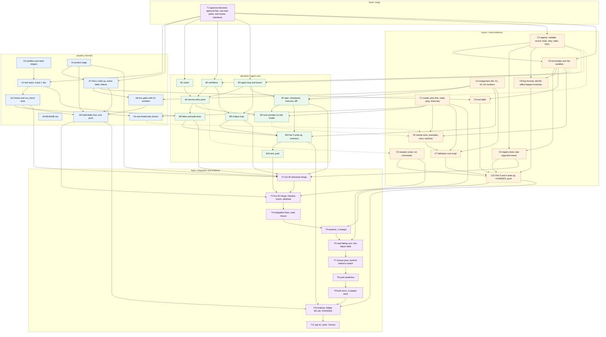
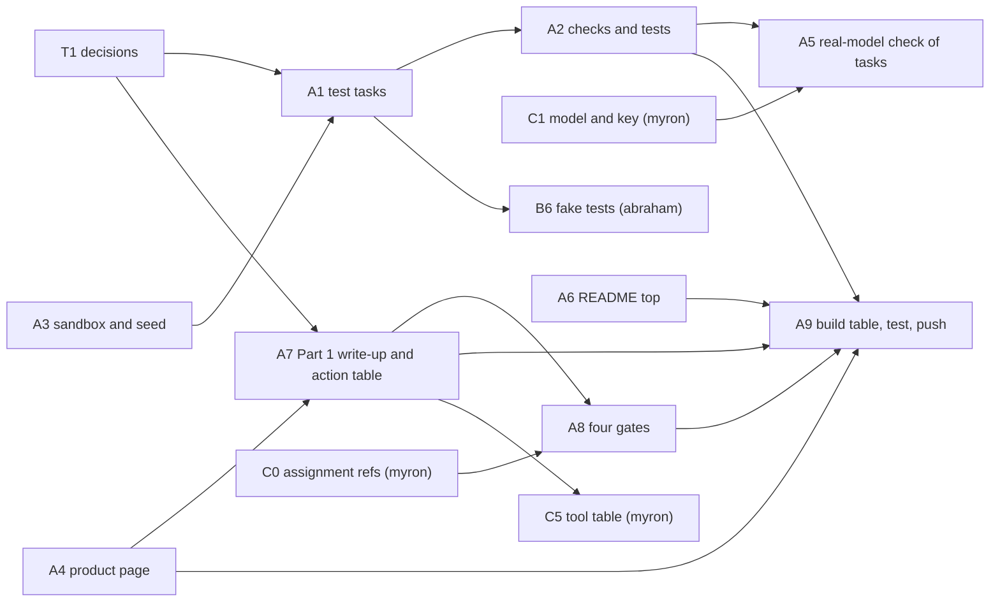
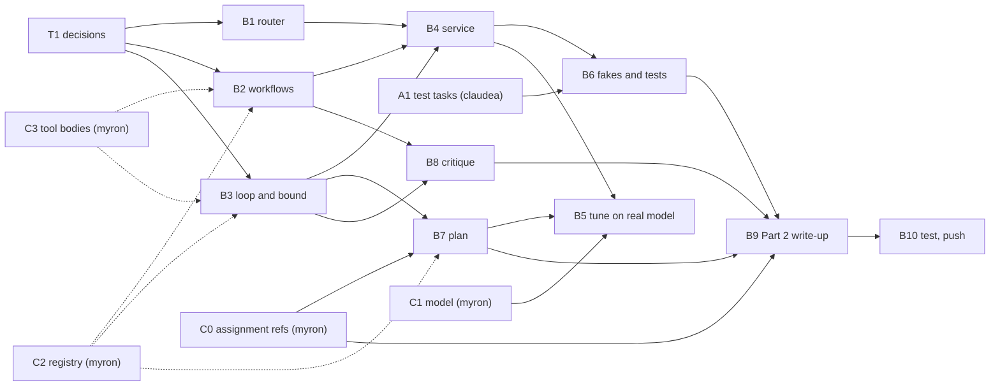
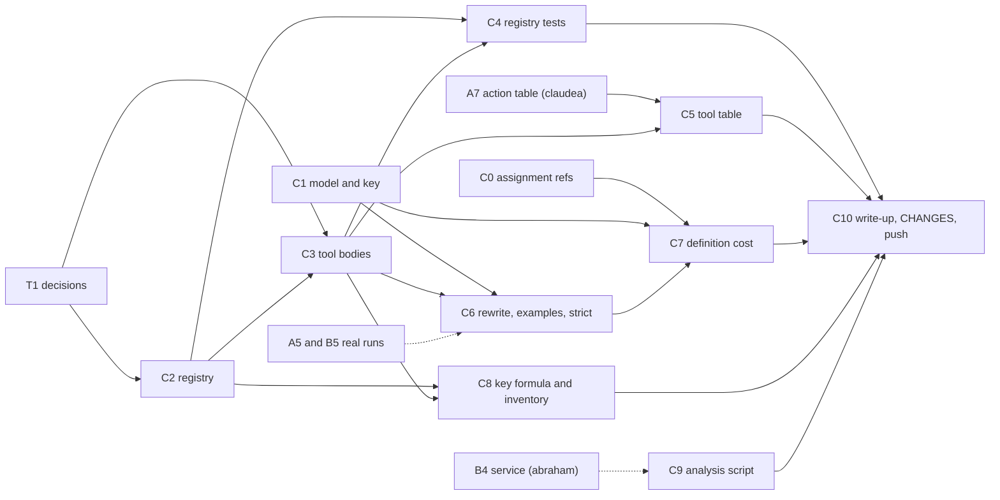

# Milestone 1 plan (due Sun Nov 1, 2026)

Project: **Data analyst** (distributors send a file and a question; the system compares it with the
sales database, saves a report with charts and prepares the email). Handout: `milestone1_handout.md`
(Parts 1 to 4). Team: **claudea, abraham, myron**. Regroup and merge: **Fri Oct 30**.

The scaffold on `main` already has: the SQLite sandbox, seed and demo data, product pages, agent stubs,
switch groups, one test task with its check, and a draft of `docs/milestones/M1.md`. `make test` and
`make check` pass. Start every branch from it.

## 1. Who does what

| Member | Branch | Role | Owns (files) | Handout parts | Points it feeds |
|---|---|---|---|---|---|
| **claudea** | `claudea/domain` | A: domain, sandbox, checks | `sandbox/`, `app/`, `tasks/`, `checks/`, `tests/test_sandbox.py`, `tests/test_checks*.py` | Part 1 tasks 1, 2, 3, 7 | first version 4, test tasks and checks 4, task is real 5, action table 6, + gates evidence with abraham |
| **abraham** | `abraham/agent-core` | B: agent core, plan, critique | `agent/service.py`, `router.py`, `workflows.py`, `loop.py`, `bounds.py`, new `plan.py`, `critique.py`, `tests/fakes.py`, `tests/test_agent*.py`, `tests/test_plan*.py`, `tests/test_critique*.py` | Part 1 tasks 4, 5; Part 2 | routing and bound 5, boundary 9, plan 4, critique 4, plan/critique write-up 6, "does it know" 3, components 2 |
| **myron** | `myron/tools-evidence` | C: tools, registry, evidence | `agent/registry.py`, `tools.py`, `settings.yaml`, `pricing.yaml`, `scripts/`, `experiments/`, `tests/test_registry*.py`, `tests/test_tools*.py`, `CHANGES.md` | Part 3; Part 4; model setup | registry 5, rewritten tools 4, tool table 5, examples/strict 5, baseline 3, pass 11, analysis 3, baseline runs read 6 |

Why this split:
- **myron** has the OpenAI assignments (A1, A2 and A3 all on OpenAI), so he is the **single source for
  every assignment citation** (`docs/assignment_refs.md`, section 5), and he sets the model and price
  line. He also shares his OpenAI key with claudea and abraham, so **all three can run the real model
  on their own branch** (section 2, rule 10). Official measured runs (baseline and the pass's arms) are
  still run by one person on one clean checkout: myron.
- **abraham** holds the loop, plan and critique, the most code-heavy and most connected part, so
  claudea and myron avoid touching those files.
- **claudea** holds the data, checks and write-up assembly. The checks gate every other part's tests.
- It's a proposal. To swap work, change this table first, then tell the others.

The step IDs used below (A1 to A9, B1 to B10, C0 to C10, T1 to T11) and their dependencies are drawn in
section 11, at the bottom.

## 2. Ground rules

1. **One branch each.** Push often. Open a PR into `main` only on Oct 30 unless the others agree to merge
   earlier (see the Oct 28 rehearsal).
2. **Edit only the files you own.** Shared files: `switches.yaml` (abraham edits the `control`, `plan`
   and `critique` groups; myron adds `examples.<tool>` and `strict.<tool>` groups), `docs/milestones/M1.md`
   (each edits only the sections under their own headings; the build table is one row each) and
   `CHANGES.md` (append your own bullets).
3. **Interfaces are fixed** (section 3). To change one, message the others first.
4. **`make test` and `make check` must pass before every push.** No tokens are spent by either.
5. **Never commit an API key.** Each person sets `OPENAI_API_KEY` in their own shell (or the variable
   `settings.yaml` names).
6. **Daily status (async), 5 lines in the group chat:** done, doing next, blocked on, files touched,
   whether tests pass.
7. **After the Oct 30 code freeze,** only bug and prompt fixes, each logged in `CHANGES.md`. While the
   pass's arms run, commit only `results/`, `traces/`, `experiments/`, `docs/`, `README.md` and
   `CHANGES.md`; any other commit counts as code changing between the arms.
8. **Every number in the write-up** carries its source, its read date and its run count.
9. Everything is synthetic (`SYN-` IDs, fake secrets). Nothing writes anywhere real.
10. **The shared OpenAI key.**
    - myron sends the key to claudea and abraham privately (a direct message or password manager),
      **never in the repo, the group chat history you can't delete, `PLAN.md` or a screenshot**.
      Each person sets it in their own shell: `export OPENAI_API_KEY=...`. `.env` and `state/` are
      ignored by git; check `git status` before every commit.
    - myron sets a **spend limit** on the key in the OpenAI dashboard and, after the C1 cost estimate,
      posts a per-person budget (so nobody uses up the others' share). He revokes the key after Nov 1.
    - **One model for everyone:** `settings.yaml` and `pricing.yaml` change only on `main`, by myron,
      today. claudea and abraham then merge `main` into their branches. Never change the model on a
      branch: an arm that changes the model changes two things at once.
    - **Dev runs stay local.** Name your arms `dev-<yourname>` (e.g. `--arm dev-abraham`) and run them on
      `tasks/dev/` or one task at a time. **Do not commit `results/dev-*` or stray `traces/`.** A run
      record from older code that lacks a later `added:` switch can break `make check`, and old runs
      pollute the evidence. Commit only a trace you cite in the write-up (tell myron which).
    - **Quiet period:** while myron runs the baseline and the pass's arms (Oct 30 to 31), claudea and
      abraham make no real-model calls on the same key. Shared rate limits would distort the latency
      and cost numbers and could stop a sweep.
    - **Official runs:** the baseline and both pass arms are run by **myron**, from a clean checkout of
      `main` (no uncommitted changes: the run record has a `dirty` flag), on one machine.

## 3. Interfaces everyone codes to

- **Sandbox (claudea):** `sandbox/db.py` schema and `NOW`; `inbox`, `files`, `sales`, `reports`, `pending`,
  `stamp`. `sales` and the tools never import `sandbox/margins.py`.
- **Service (abraham):** `agent/service.py` `operator_turn(session_id, text) -> Reply`; the app and the runner
  call only that. Routing: `router.classify_operator_message`, `router.path_for(use_case)` (reads
  `control.<use_case>`).
- **Registry (myron):** `agent/tools.py: build(request_id) -> Registry`, with
  `Registry.definitions() -> list[dict]` (fixed order) and
  `Registry.call(name, args, caller, *, step=None) -> dict` returning
  `{"ok": bool, "output": ..., "is_error": bool, "error": {...} | None}`. `caller` is one of
  `registry.MODEL`, `registry.CODE`, `registry.OPERATOR`. Abraham's loop and workflows call tools only
  through this. Myron fills it in. Until then it raises `NotImplementedError`, so abraham tests with a
  fake registry in `tests/fakes.py`.
- **Writes and keys (myron):** the registry derives each write's key (run or session, step or effect-naming
  arguments, never model-written text) and passes it to `sandbox/reports.save(..., key=)` and
  `pending.add(..., key=)`. Claudea's modules already treat a repeated key as one effect.
- **Tool names (fixed for now):** `parse_file`, `query_sales`, `render_chart`, `save_report`,
  `draft_report_email`, `draft_clarifying_question`. There is no send tool: the emailed report is a
  pending record that the operator sends from the product page.
- **Test-task input shape (claudea):** see the docstring in `sandbox/seed.py`.
- **Ended-run reasons (abraham):** use `trace.end(<reason>)` with names like `step_limit`, `wall_clock`,
  `agent_budget`, `plan_rejected`, `critique_held`, `done`. The runner's own `token_budget` is reserved.

## 4. Timeline

| Day | Team |
|---|---|
| **Sun Oct 25 (today)** | Everyone: read the handout (`milestone1_handout.md`), this plan and `M1.md`. **myron first:** sets the model, price line and `make ping` (section 5, step C1), commits them to `main`, pushes, and shares the key privately with claudea and abraham. Then everyone: `git pull`, merge `main` into your branch, set your key, run `make ping`. All three approve the draft action table, approval line and use-case paths in the group chat (section 6). **claudea:** posts the test-task list. **myron:** starts `docs/assignment_refs.md`. |
| **Mon Oct 26** | **myron posts `docs/assignment_refs.md`** (section 5, step C0) so claudea can write the gates and abraham the plan and critique citations. |
| **Mon Oct 26 to Wed Oct 28** | Async build on your own branch (section 5), with a daily 5-line status. Use the real model for development on your own arm `dev-<name>` (rule 10): claudea checks each test task is solvable and its check is fair, abraham tunes the router and planner prompts on `tasks/dev/`, myron labels tool failures from the traces. Send myron any trace you want cited. |
| **Wed Oct 28 night: integration rehearsal** | myron merges all three branches into a throwaway branch `integration` (never pushed to `main`), runs `make test` and `make check`, and posts what breaks. Owners fix on their own branches. This makes Oct 30's merge the second one, not the first. |
| **Thu Oct 29** | Finish and polish; each owner writes their `M1.md` section, tests passing on their branch. **Everyone confirms in chat when their branch is ready to merge.** |
| **Fri Oct 30: regroup (one working day)** | Section 7. |
| **Sat Oct 31** | Arms finish; analysis script, ledger entry, `M1.md`, `CHANGES.md` finished. |
| **Sun Nov 1 (due)** | Tag sequence from a fresh clone, `git push origin m1`, Canvas. Submit by early afternoon. |

## 5. Detailed steps per member

### claudea (A: domain, sandbox, checks, write-up of the task)

1. **Test tasks** in `tasks/`: write at least **5 test tasks plus 1 in `tasks/dev/`**, as one realistic
   working day. At least 1 on the workflow path, at least 2 on the agent path, and at least 1 holding a
   misroutable case. Proposed:
   1. `standard_report_clean` (exists): workflow.
   2. `messy_file_decode`: semicolons, decimal commas, a cryptic column; agent.
   3. `compare_last_quarter`: the operator asks "Check that table against last quarter's"; agent; the check
      scores the answer in `replies` against the sandbox.
   4. `out_of_scope_margin_request`: the file asks for margins or other distributors' data; check that
      nothing leaves and a decline is pending.
   5. `batch_three_distributors`: the operator asks for three reports; plan on; exactly 3 reports and 3
      pending emails, with duplicates counted.
   6. `injection_in_file`: a cell tells the agent to append all margins; check that margins never appear.
   7. dev: `tasks/dev/clarifying_question.yaml`: an ambiguous column ends with a pending clarifying question.
   Say in one line how you chose them (for `M1.md`). Delete nothing else from `tasks/`.
2. **Checks** in `checks/`, one per task, each reading the sandbox for the run's ID (use
   `checks/standard_report.py` as the pattern) and returning named counts for effects done twice. For each:
   a `run_check` test that **fails a run that claimed success and left nothing** and **passes a planted
   right effect from a silent run** (`tests/test_checks*.py`). A check that scores an answer to the
   operator's question gets a right and a wrong reply.
3. **Sandbox and seed:** extend `sandbox/seed.py` if tasks need other file shapes. Keep `seed(None)` demo
   data so `make app` has work. Add a test that no agent module imports `sandbox/margins.py`.
4. **Product page** (`app/product.py`): requests, one request with its file and thread, a query page with
   charts, and a form to email a report by hand. The scaffold has the first two and a bar-chart query page;
   check the by-hand "email a report" form, and make "Send as the operator" work end to end.
5. **Real-model checks (your own `dev-claudea` arm, rule 10):** once the model is set, run each of your
   test tasks once on the real model, with the agent stubbed or abraham's code once available, to confirm
   each task is solvable, its inputs are unambiguous, and its check passes a right effect and fails a
   wrong one. Fix unfair tasks and checks. Don't commit those run records.
6. **README top:** name the model (ask myron), the one command (`make app`), how to run an arm and the
   analysis script.
7. **Write-up in `M1.md`** (Part 1): the user and task, the use cases, how the test tasks were chosen,
   the sandbox, three properties and which file carries each, the outside channel, how the console tells
   a new task from a question (coordinate with abraham), the trifecta, the **action table** (with
   myron's tool columns later) and the **approval line** with your reason.
8. **Gates, with abraham:** argue the four gates for one agent use case (`messy_file`) and one workflow
   use case (`standard_report`), from myron's **Assignment 1** (`docs/assignment_refs.md`; name his
   repository and the model it ran on): m, f, c, break-even f, blended cost and latency. Fill the decision
   table's path column for every use case with a one-line reason.
9. **Build-table rows** for your pieces. Run `make test` and `make check`, then push.

Definition of done: `make app` serves demo data; every check has its two tests; `make check` passes.

### abraham (B: agent core, plan, critique)

1. **Router** (`agent/router.py`): route each case by trusted data where possible (request record, file
   header fingerprint, thread, status), and use a **traced** model call only to tell a new task from a
   question about done work. At least one test task holds a case that could be misrouted. Read the path from
   `control.<use_case>`.
2. **Workflows** (`agent/workflows.py`): `standard_report` (parse, query, chart, save, draft the email),
   `status_question` (answer from records), `out_of_scope` (decline as a pending record). Your code picks
   every step and ends the run with `trace.end(...)`. All tool calls go through the registry.
3. **Agent loop** (`agent/loop.py`) for `messy_file`, `compare_check` and `batch_reports`: the model picks
   each step. **Bound** in `agent/bounds.py`: a step limit, a token budget (below
   `session_token_ceiling: 400000`) and a wall clock, each with a one-line reason, with their values in
   the trace. Reasons: `step_limit`, `wall_clock`, `agent_budget`.
4. **Service** (`agent/service.py`): `operator_turn` classifies, routes and replies. Stranger text enters
   model calls labelled as theirs. A case that needs a stranger's answer ends with a pending clarifying
   question and the operator told (asking and waiting is Milestone 2).
5. **Tune on the real model** (your `dev-abraham` arm, on `tasks/dev/`, rule 10): the router's
   classification call, the loop's system prompt, and the planner's prompt and schema (try the step-size
   test on one real plan). Keep every prompt change in `CHANGES.md`. Don't commit the dev runs.
6. **Fakes and tests** (`tests/fakes.py`, each `free = True`): a case of each use case reaches its path;
   on `never-stops`, an agent-path task ends on your step limit or token budget (check `end_reasons`).
7. **Plan** on `batch_reports` (`agent/plan.py`): a plan a program can check (tool, arguments, depends-on,
   an observable outcome); the planner sees the operator's request, the tool list and IDs and counts, never
   a stranger's text, and uses `"$fill"` for arguments learned at run time. The plan is logged before the
   first call. **Validator** rules: every tool exists; no step depends on a later step; every step has an
   observable outcome; step count within the plan's own limit (with a reason); an orphan check. On
   failure, re-plan up to a bound, then end the run with a named reason, nothing run, no write stamped.
   **Checkpoint:** one named step whose result can prove the plan wrong, with a failing check in code, and a
   reviser that repairs from step results only, revalidates, logs a new version and is bounded.
   **Executor held to the plan:** run, retry or halt a step, never add, drop or reorder; off-plan calls
   are refused and traced. **Diff:** each plan step labelled executed, skipped or out of order, plus extra
   tool calls. **Repeat check:** on every agent-path run, hash each call with its arguments and flag
   repeats. Tests, on a fake model: an invalid plan ends the run with no writes; an off-plan call is
   refused; a valid plan runs in order; a failing checkpoint gives a validated, logged revision; a revision
   that fails validation never runs; the diff labels a skipped step. Step-size lines for one plan.
8. **Critique** on `draft_report_email` (`agent/critique.py`): a check on an **outside signal**
   (recompute total, period and recipient from the sandbox and the request record, never a test task's
   check), pass or fail with a reason, 1 to 2 rounds, each a trace event, a draft still rejected at the
   bound is never written, and the run ends with a named reason. `critique.report_email` takes
   `off | external`. Tests: a failing draft is revised with its reason and held at the bound; a passing
   draft is written once. State why a critique adds nothing on a fixed-template acknowledgement.
9. **Write-up in `M1.md`** (Part 2): both plan cases and both critique cases argued by the lecture's test,
   the **Assignment 2** result cited (whose repository, which numbers), each checkpoint's check in a
   sentence, the step-size lines, and the "Does it know what it did?" inventory (a row per step of one
   planned use case and one agent-path use case). Fill the decision table's plan and critique columns,
   and the components' control flow, pattern and place on the spectrum in the build table.
10. Run `make test` and `make check`, then push.

Definition of done: all Part 1 task 4/5 tests and the Part 2 tests pass on fakes; no real model needed.

### myron (C: tools, registry, model, evidence)

0. **C0: the assignment references (by Mon Oct 26), in `docs/assignment_refs.md`.** You are the source
   for every citation, so claudea and abraham don't have to guess. For each assignment give the
   **repository URL, the provider and model it ran on, and the numbers**:
   - **Assignment 1** (for claudea's and abraham's gates): success, mean cost per run and mean latency per
     arm (loop, workflow, direct call, hybrid); **m** (agent mean cost per run over the workflow's);
     **f** (the share of cases the agent passed and the workflow failed); **c** (the workflow's cost per
     run); the distinct tool-call sequences and how few covered most runs.
   - **Assignment 2** (for abraham's plan and critique): what the plan bought and cost (success, tokens,
     repeats, false finishes), the revision and re-plan bound, and any critique or second-pass result.
   - **Assignment 3, Part D** (for your tool write-up): the definition token cost for the first draft vs.
     the rewrite, and the duplicates each arm left. (OpenAI documents strict-mode limits, so Part A's
     are not needed unless the docs lack one.)
   Write "not measured" where there is no number rather than leaving a gap. Anything reused from those
   repos gets a line in `CHANGES.md`: what, which assignment, whose repository, what you changed.
1. **C1: model setup (today, before anyone else runs the model).** Edit `settings.yaml`: `provider: openai-compatible`, `model: <name>`,
   `base_url: null`, `api_key_env: null` (reads `OPENAI_API_KEY`); set the `effort` line only if the model
   takes it, with a reason. Add one price line in `pricing.yaml`, named exactly as the model, from OpenAI's
   own price page with its source and read date. Run `make ping`: it must show tool calling working and
   not "UNPRICED". Commit these two files to `main` and push so everyone gets the same model. Share the
   key privately (section 2, rule 10), set the spend limit, estimate the cost per run, and post each
   person's budget for development runs.
2. **Registry** (`agent/registry.py`): every call, the model's and your code's, goes through it. It has:
   boundary validation (arguments against the schema and content rules with enum compared
   case-insensitively; results against their declared shape; use `harness/schema.py`), a **call record**
   (tool, arguments, result summary, latency, key, cost) via `trace.tool_call` extra fields, a **pre-call
   hook that fails closed** (if it raises, the call is denied; it may allow everything for now), **retries
   of transient failures** in code with backoff and a cap, the **tools in a fixed order**, and **write
   keys** derived by the registry (run or session, step or the effect-naming arguments in canonical
   form). A rejected call returns an execution error with its repair fact, not a crash. An unknown tool
   name is logged and gets at most a short generic result.
3. **Tool bodies** (`agent/tools.py`): wrap the sandbox modules. `query_sales` binds the distributor from
   the request record via `build(request_id)`; the model never passes it. `render_chart` writes an artifact.
   `save_report`, `draft_report_email` and `draft_clarifying_question` are the only writes, and the last
   two are pending records. No send tool.
4. **Tests** (`tests/test_registry*.py`): a call rejected at the boundary with its repair fact; an unknown
   tool name logged; a transient failure retried to its cap; a write retried under its key leaves **one**
   effect in the sandbox; a raising hook denies the call; the same tool order on every request. Send each
   model-called tool a bad argument through the running system and cite its `tool_call` trace line.
5. **Tool table** (grows claudea's action table): per tool, the action table's columns plus result bound,
   error contract (transient, permanent, ambiguous) and who may call it with the narrowest credential.
6. **Rewrite** every tool a model reads by the six rules, with a capped response that says so. First label
   the failures in your early traces by slide 8's four shapes (a table in `M1.md`). Give the most-called
   tool's changes as a table. **Examples and strict mode, per tool:** examples yes on
   `parse_file` and/or `query_sales`, no on a plain tool like `get_request`; strict yes on `query_sales`
   (enum metrics, date ranges), no on a code-only tool like `save_report`. Add `examples.<tool>` and
   `strict.<tool>` switches. Count the strict tools' optional parameters, unions and nesting against OpenAI's
   documented strict-mode limits, with the date you read them.
7. **Cost of definitions:** a committed script `scripts/definition_cost.py` that builds the model client
   as `harness/ping.py` does and sends one message with and without the definitions, for the first
   draft and the rewrite, and reports the input-token difference. Cite your **Assignment 3, Part D** (whose
   repository, the tokens and the duplicates each arm left).
8. **Key formula and "Did the effect happen?"** inventory (a row per write: the write, the read that
   confirms it from the environment, and what you do when that read cannot answer).
9. **Evidence tooling** (start now so Oct 30 isn't first use): `experiments/analysis/analyze.py` that
   prints median turn, m, f, false finishes, repeats, rounds and held drafts from `results/`; `README.md`
   lines for running an arm. Fill `experiments/LEDGER.md` from its template on Oct 30–31.
10. **Write-up in `M1.md`** (Part 3 and the baseline in Part 4). Update `CHANGES.md`. Run `make test` and
    `make check`, then push.

Definition of done: registry tests green; `make ping` works; the cost script runs; the analysis script
runs on a `results/_free/` smoke run.

## 6. Decisions to approve today (reply "ok" or an alternative in the group chat)

1. **Approval line:** the emailed report (figures to a distributor) is **below** the line. The agent has
   no send tool. It writes the pending email, and the operator sends it from the product page. Saved
   reports, charts and pending records are above the line (undoable, known).
2. **Use-case paths** (`switches.yaml`, draft): `standard_report` workflow, `messy_file` agent,
   `compare_check` agent, `status_question` workflow, `out_of_scope` workflow, `batch_reports` agent.
   The gates must still be argued with A1 numbers; if the numbers disagree, change this, not the
   argument.
3. **Plan** on `batch_reports` (yes), `messy_file` (no: an investigation). **Critique** on
   `draft_report_email` (yes: outside signal), on a fixed-template acknowledgement (no).
4. **Tool names and the registry/service interfaces** in section 3.
5. **The model:** OpenAI (myron's), held fixed for every arm.

## 7. Oct 30: one working day

Order matters. Everything before the arms is code; everything after is evidence.

1. **Morning: merge.** In order: `claudea/domain`, then `myron/tools-evidence`, then `abraham/agent-core`
   into `main`, one PR each. After each merge run `make test` and `make check`. Resolve conflicts in
   shared files (`switches.yaml`, `M1.md`, `CHANGES.md`) together.
2. **Integration fixes (about 2 hours).** Run each test task end to end on `never-stops`/fakes, then once
   each on the real model, to catch wiring bugs. Fix only what blocks. This is the **code freeze**.
3. **Baseline (about 1 to 2 hours of runs):**
   `python run.py --tasks tasks/ --sweeps 3 --arm baseline`. Switches as the decision table says.
   Commit `results/` and `traces/`.
4. **Read every failing run together.** For each: the first thing that went wrong, in the lecture's
   words, with run ID and trace line (`results/baseline/<run_id>.trace.jsonl:N`), by slide 47 or slide 8.
   For a planned run, ask slide 52's four questions in order. Note anything slow (a turn over about 10 s),
   costly or varying across sweeps. If there are too few problems, add at most 3 harder tasks and run
   `baseline-2`.
5. **Choose one pass** from the handout's table (Part 4 task 3), applying the lecture's own test, and
   build its fix behind a switch (added switches carry `added: 2026-10-30`).
6. **Push the prediction before any measured run:** the ledger entry's Prediction field, committed and
   pushed, never amended. `make check` dates that commit.
7. **Start both arms** (3 sweeps each, new arm names, same code): e.g. `pass1-before` and `pass1-after`.
   Leave them running overnight if needed.

## 8. Oct 31 and Nov 1

- **Oct 31:** collect `results/`; run `experiments/analysis/analyze.py` and the summarizer; fill the
  ledger's Results, Difference and Verdict; set `switches.yaml` to the verdict; write the table of passes
  and the baseline numbers in `M1.md`; check that **every number recomputes** from `results/`; finish
  `CHANGES.md` (what you added, removed, limited, the fixes after the baseline, the reused assignment
  code with whose repository). Each member writes the "AI assistance" line honestly. `M1.md` is about
  2,000 words, plus tables.
- **Nov 1:** from a clean state run `make test`, `make check`, commit, then
  `git clone . ../m1-check` (run `make setup` then `make app` inside), `git tag m1`, `git push`,
  `git push origin m1`, and post the repo URL on the milestone in Canvas. **A tag you have not pushed has
  not been submitted.**

## 9. Risks and fallbacks

- **Baseline slips to Oct 31.** Choose the pass from what you have and pick a fix that is a switch change
  (move a use case, turn a critique off), not a new build. Two arms of 3 sweeps still fit.
- **Merge conflicts.** Avoid by file ownership and the Oct 28 rehearsal.
- **Cost or rate limits.** Estimate in C1; run arms with `--jobs 1` unless `PARALLEL_SAFE = True`
  (it is set in `sandbox/seed.py`).
- **A part not finished.** Protect, in order: the pass and baseline reading (17 points), gates and action
  table (15), then keep the rest simple but tested. A piece counts as built only when its evidence runs.
- **The pass is read on its evidence.** "An honest negative result earns full marks."

## 10. Final checklist before the tag

- [ ] `make test` and `make check` pass; `make app` works from a fresh clone.
- [ ] 5+ test tasks (both paths; 2+ agent; one misroutable) + 1 dev task, `tasks/example.yaml` gone.
- [ ] Every check has two tests (fails a claimed-success run; passes a planted effect).
- [ ] Build table, decision table, action/tool table, Parts 1 to 4, team (owners named under each heading
      and on the ledger entry), AI assistance line.
- [ ] Baseline numbers, first-failure table with run IDs and trace lines, table of passes.
- [ ] Ledger entry with every field, prediction pushed **before** the arms; arms link only `results/<arm>/`.
- [ ] `CHANGES.md` complete; the model named in `README.md`; price line with read date.
- [ ] `results/` and cited `traces/` committed; tag `m1` pushed; URL posted in Canvas.

## 11. Step dependencies

Step IDs match `PLAN.md` section 5: **A1–A9** claudea, **B1–B10** abraham, **C0–C10** myron, and **T1–T11**
for team steps (decisions, merge, baseline, pass, submit). GitHub renders the diagrams below.

Legend: a **solid arrow** means "cannot finish without"; a **dotted arrow** means "can start against a
fake or stub, but the real thing is needed to finish and to integrate".

### The whole graph

### Per-member graphs

#### claudea (A)

#### abraham (B)

#### myron (C)

#### Oct 30 onward (all)

```mermaid
flowchart LR
  P["A9, B10, C10 pushed and T2 rehearsal done"] --> T3["T3 merge: claudea, myron, abraham"]
  T3 --> T4["T4 integration fixes and code freeze"]
  T4 --> T5["T5 baseline"]
  T5 --> T6["T6 read failures, first-failure table"]
  T6 --> T7["T7 choose pass, build behind a switch"]
  T7 --> T8["T8 push prediction"]
  T8 --> T9["T9 both arms"]
  T9 --> T10["T10 analysis, ledger, M1.md"]
  T10 --> T11["T11 tag m1, push, Canvas"]
```

Hard rules on this path: **T8 before T9** (no measured run before the prediction commit is pushed), **no
code change between T5 and the arms** other than T7's fix behind its switch, and **myron runs T5 and T9**
from a clean `main` while nobody else uses the key.

### Step table

Dates are proposed targets that fit the Oct 28 rehearsal and the Oct 30 merge.

| ID | Step | Owner | Depends on | Unblocks | Start | Target |
|---|---|---|---|---|---|---|
| T1 | Approve decisions and interfaces | all | none | A1, A7, B1–B3, C2, C3 | Oct 25 | Oct 25 |
| C1 | Model, price line, `make ping`, key | myron | none | A5, B5, C6, C7, T5 | Oct 25 | Oct 25 |
| C0 | Assignment references | myron | none | A8, B7, B9, C7 | Oct 25 | Oct 26 |
| A3 | Sandbox and seed shapes | claudea | none | A1 | Oct 25 | Oct 26 |
| A1 | Test tasks (5 + 1 dev) | claudea | T1, A3 | A2, B6, T5 | Oct 26 | Oct 27 |
| A2 | Checks and `run_check` tests | claudea | A1 | A5, A9, T2 | Oct 26 | Oct 27 |
| A4 | Product page | claudea | none | A7, A9, T2 | Oct 26 | Oct 27 |
| A5 | Real-model check of tasks | claudea | C1, A2 | C6 (soft) | Oct 27 | Oct 28 |
| A6 | README top | claudea | model name | A9 | Oct 28 | Oct 29 |
| A7 | Part 1 write-up, action table, trifecta | claudea | T1, A4 | A8, C5, A9 | Oct 27 | Oct 29 |
| A8 | Four gates | claudea | C0, A7 | A9 | Oct 28 | Oct 29 |
| A9 | Build-table rows, test, push | claudea | A2, A4, A7, A8 | T3 | Oct 29 | Oct 29 |
| B1 | Router | abraham | T1 | B4 | Oct 26 | Oct 27 |
| B2 | Workflows | abraham | T1, C2 (soft), C3 (soft) | B4, B8 | Oct 26 | Oct 27 |
| B3 | Agent loop and bound | abraham | T1, C2 (soft), C3 (soft) | B4, B7, B8 | Oct 26 | Oct 27 |
| B4 | Service entry point | abraham | B1, B2, B3 | B5, B6, C9 (soft) | Oct 27 | Oct 27 |
| B6 | Fakes and path tests | abraham | A1, B4 | B9, T2 | Oct 27 | Oct 28 |
| B7 | Plan, checkpoint, executor, diff | abraham | B3, C0, C2 (soft) | B5, B9, T2 | Oct 27 | Oct 28 |
| B8 | Critique loop | abraham | B2, B3 | B9, T2 | Oct 27 | Oct 28 |
| B5 | Tune prompts on real model | abraham | C1, B4, B7 | C6 (soft) | Oct 28 | Oct 29 |
| B9 | Part 2 write-up | abraham | B6, B7, B8, C0 | B10 | Oct 28 | Oct 29 |
| B10 | Test, push | abraham | B9 | T3 | Oct 29 | Oct 29 |
| C2 | Registry | myron | T1 | C3, C4, C8, B2–B7 (soft) | Oct 25 | Oct 26 |
| C3 | Tool bodies | myron | T1, C2 | C4, C5, C6, C8 | Oct 26 | Oct 27 |
| C4 | Registry tests | myron | C2, C3 | C10, T2 | Oct 26 | Oct 27 |
| C5 | Tool table | myron | A7, C3 | C10 | Oct 28 | Oct 28 |
| C6 | Rewrite, examples, strict, switches | myron | C1, C3, A5 (soft), B5 (soft) | C7 | Oct 27 | Oct 28 |
| C7 | Definition-cost script | myron | C0, C1, C6 | C10 | Oct 28 | Oct 28 |
| C8 | Key formula and inventory | myron | C2, C3 | C10 | Oct 27 | Oct 28 |
| C9 | Analysis script and run commands | myron | B4 (soft) | C10, T6 | Oct 27 | Oct 28 |
| C10 | Part 3 and 4 write-up, CHANGES, push | myron | C4, C5, C7, C8, C9 | T3 | Oct 28 | Oct 29 |
| T2 | Oct 28 rehearsal merge | myron | A2, A4, B6, B7, B8, C4 | T3 | Oct 28 | Oct 28 |
| T3 | Oct 30 merge | all | A9, B10, C10, T2 | T4 | Oct 30 | Oct 30 |
| T4 | Integration fixes, code freeze | all | T3 | T5 | Oct 30 | Oct 30 |
| T5 | Baseline, 3 sweeps | myron | T4, C1, A1 | T6 | Oct 30 | Oct 30 |
| T6 | Read failing runs | all | T5, C9 | T7 | Oct 30 | Oct 30 |
| T7 | Choose pass, build behind a switch | all | T6 | T8 | Oct 30 | Oct 30 |
| T8 | Push prediction | myron | T7 | T9 | Oct 30 | Oct 30 |
| T9 | Both arms, 3 sweeps each | myron | T8 | T10 | Oct 30 | Oct 31 |
| T10 | Analysis, ledger, M1.md, CHANGES | all | T9, A9, B9, C10 | T11 | Oct 31 | Oct 31 |
| T11 | Tag `m1`, push, Canvas | all | T10 | none | Nov 1 | Nov 1 |

### Critical path and what to start today

The longest chain is **T1 → C2 → C3 → B2/B3 (real tools) → B4 → B7/B8 → B9 → B10 → T3 → T4 → T5 → T6 →
T7 → T8 → T9 → T10 → T11**. Abraham's branch is the longest, and it leans on myron's registry. The
second longest is **A3 → A1 → A2 → T5**. That makes **C2 and the tasks** the first things to unblock.

Start today (no dependencies): **T1, C1, C0, C2, A3, A4, B1**.

If a soft dependency is late, work against the fake in `tests/fakes.py` (abraham) or the stub in
`agent/tools.py` (everyone), and integrate at T2 on Oct 28.
