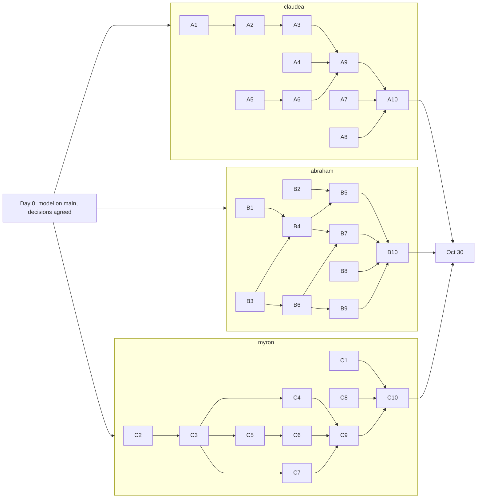
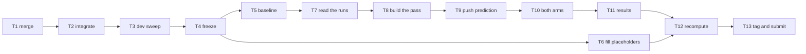

# Milestone 1 plan

**Project:** Data analyst. **Team:** claudea, abraham, myron. **Due:** Sun Nov 1, 2026.
**Handout:** `../milestone1_handout.md` (Parts 1 to 4).

**How it works:** today (Day 0) we do a short shared setup. From Oct 26 to Oct 29 each person works
**alone on their own branch**: nobody waits on anybody. On **Fri Oct 30** we meet, merge, and finish
everything else together. Oct 31 and Nov 1 are buffer only.

## 1. Who owns what

| Member | Branch | Owns | Handout parts |
|---|---|---|---|
| **claudea** | `claudea/domain` | The data and the **workflow path**: sandbox, test tasks, checks, product page, the three workflows, the critique, the analysis script | Part 1 tasks 1, 2, 3, 7 · Part 2 task 2 · Part 4 task 5 · the build table |
| **abraham** | `abraham/agent-core` | The **agent path**: router, service, agent loop and its bound, the plan, the four gates | Part 1 tasks 4, 5 · Part 2 tasks 1, 3 · Part 4 task 2 |
| **myron** | `myron/tools-evidence` | The **tools**: model setup, registry, tool definitions and their rewrite; and the official runs and the pass | Part 1 task 6 · Part 3 · Part 4 tasks 1, 3, 4, 6 · all assignment citations |

Myron's assignments (A1, A2, A3) ran on OpenAI, our model, so every assignment number we cite comes from
his repositories. He shares his OpenAI key so all three can use the model while building.

## 2. Rules

1. **Work only on your own branch and your own files** (section 3). Nothing merges into `main` before Oct 30,
   except the Day 0 setup (section 4).
2. **Follow the contracts in section 3.** Code against the fakes and stubs on `main` (`FakeRegistry`,
   `ScriptedTools`, the critique and workflow stubs, `agent/events.py`) and the tool contract table, never
   against another person's branch. Use the exact function names, tool names, arguments, output fields and
   event names written there. **To change a contract, tell the other two first**, and update section 3 the
   same day.
3. **`make test` and `make check` pass before every push.** Neither spends tokens.
4. **Never commit the API key.** myron shares it privately; set it with `export OPENAI_API_KEY=...`.
5. **The model is set once, on `main`, by myron.** Never change it on a branch.
6. **Real-model dev runs** use `--arm dev-<yourname>` and are **not committed**.
7. **Anything that cites another person's work is a placeholder** (`[A1: m]`, `[A2: ...]`, `[task: ...]`,
   `[abraham: ...]`) and is filled in on Oct 30.
8. **Every number** in the write-up has its source, read date and run count.
9. **On Oct 30, while myron runs the baseline and the arms, nobody else uses the key.** After the code
   freeze, only bug and prompt fixes (logged in `CHANGES.md`); while the arms run, commit only `results/`,
   `traces/`, `experiments/`, `docs/`, `README.md` and `CHANGES.md`.

## 3. Files and the shared contracts

| Owner | Files |
|---|---|
| claudea | `sandbox/`, `app/`, `tasks/`, `checks/`, `agent/workflows.py`, `agent/domain_workflows.py`, `agent/critique.py`, `experiments/analysis/analyze.py`, top of `README.md`, the `critique` group in `switches.yaml` |
| abraham | `agent/service.py`, `router.py`, `loop.py`, `bounds.py`, `plan.py`, `experiments/analysis/failures.py`, `tests/fixtures/agent_*`, the `control` and `plan` groups in `switches.yaml` |
| myron | `agent/registry.py`, `agent/tools.py`, `settings.yaml`, `pricing.yaml`, `scripts/`, `experiments/LEDGER.md`, `docs/assignment_refs.md`, the `examples` and `strict` groups in `switches.yaml` |
| everyone | your own sections of `docs/milestones/M1.md`, your own bullets in `CHANGES.md`, your own tests in `tests/` |

**Why nobody has to wait:** everything shared is already on `main`. Code against it, not against
someone's branch:

- `tests/fakes.py`: **`FakeRegistry`**, with the same calls as the real registry
  (`call(name, args, caller, step=None)` and `definitions()`), and **`ScriptedTools`**, a fake model.
- `agent/critique.py`, `agent/workflows.py`, `agent/domain_workflows.py`: **stubs** with the final function
  signatures. The critique passes drafts through when its switch is off.
- `agent/events.py`: the shared **trace event names and end reasons**.
- `sandbox/`, demo data, one test task and its check, and the **draft action table** in `M1.md`.

### The tool contract (agreed on Day 0; owner: myron)

claudea's workflows and abraham's loop call these tools through the registry, so their **names,
arguments and output fields are fixed**. Tests use `FakeRegistry` with these exact shapes. The request
(and so the distributor and its contact) is bound by code through `tools.build(request_id)`, never passed
by the model.

| Tool | Arguments | Output (when `ok` is true) | Writes? |
|---|---|---|---|
| `parse_file` | `delimiter` (optional: `","`, `";"`, `"\t"`), `decimal` (optional: `"."`, `","`) | `file_name`, `columns` (list of str), `rows` (list of lists), `row_count`, `truncated` | no |
| `query_sales` | `period` (like `"2026Q3"`) | `distributor_id`, `period`, `by_product` (each: `sku`, `name`, `units`, `revenue`), `total_units`, `total_revenue` (what `sandbox/sales.py` `distributor_sales` returns) | no |
| `render_chart` | `title`, `labels` (list of str), `values` (list of numbers) | `chart_id`, `path` | yes (an artifact) |
| `save_report` | `kind`, `figures` (dict with at least `total_revenue` and `period`), `body` | `report_id`, `version`, `created` | yes |
| `draft_report_email` | `recipient`, `subject`, `body`, `report_id` | `pending_id`, `created` | yes (a pending record) |
| `draft_clarifying_question` | `question` | `pending_id`, `created` | yes (a pending record) |

**Every result** has the shape `{"ok", "output", "is_error", "error"}`. On failure, `is_error` is true and
`error` is `{"kind": "transient" | "permanent" | "protocol", "message": ..., "retry": true | false}`.
**Callers must handle failures**, not only success: the real registry rejects bad arguments; the fake
only rejects unknown tool names unless told otherwise.

**The Part 3 rewrite** (myron, C5) may change each tool's description, examples, error messages, result
caps and strict mode. It **may not change a tool's name, arguments or output fields** unless all three agree
first; if they do change, update this table and tell the others the same day.

Change a contract only after telling the other two.

## 4. Day 0 (today): shared setup

1. **myron:** set the model in `settings.yaml` and its price line in `pricing.yaml` (from OpenAI's price page,
   with the read date), run `make ping`, commit to `main`, push, and share the key privately.
2. **Everyone:** agree in the group chat on the approval line (the emailed report is below it: the agent
   only writes a pending email), the use-case paths in `switches.yaml`, plan on `batch_reports` and
   critique on `draft_report_email`, and this plan.
3. **myron:** make `FakeRegistry` check every call against the tool contract above (an unknown argument, a
   missing required one or a bad value returns an error result, as the real registry will), so a wrong call
   fails during the week, not on Oct 30. Commit it to `main` with step 1.
4. **Everyone (after steps 1 and 3):** `git pull`, create your branch, set your key, then run `make setup`,
   `make test`, `make check` and `make ping`.

## 5. Oct 26 to Oct 29: each member's steps

Each step depends only on your own earlier steps, shown as "after". **No step depends on another
member.**

### claudea

| Step | What | After |
|---|---|---|
| A1 | **Sandbox and seed:** the file shapes your test tasks need; a test that no agent code imports `sandbox/margins.py` | none |
| A2 | **Test tasks:** at least 5 in `tasks/` (at least 1 workflow, at least 2 agent, 1 that could be misrouted) and 1 in `tasks/dev/`; one line on how you chose them | A1 |
| A3 | **Checks:** one per task, reading the sandbox for the run's ID, returning named counts; two `run_check` tests each (a "Done." with no effect fails; a planted right effect passes) | A2 |
| A4 | **Product page:** requests, one request with its file and thread, a query page with charts, a form to email a report by hand, and the list of pending records | none |
| A5 | **Critique** (`agent/critique.py`): recompute the total, period and recipient from the sandbox; 1 to 2 rounds, each a `critique` trace event; a draft still failing at the bound is never written. Tests: `check` alone; `run` with a fake `revise`; and through your workflow (A6) on a fake model, with `FakeRegistry`'s `draft_report_email` calling `pending.add` so the test counts real pending records (written once when it passes, none when held) | none |
| A6 | **Workflows:** `standard_report` (parse, query, chart, save, critique, pending email), `status_question` and `out_of_scope`. Test them with `FakeRegistry` inside `fixed_run` | A5 |
| A7 | **Analysis script** (`analyze.py`): every number the summarizer doesn't give (median turn, m, f, repeats, plan diff counts, critique rounds and held drafts, misroutes, bound endings, boundary rejections, check measures). Test it on run records you write by hand | none |
| A8 | **README top:** the model, `make app`, how to run an arm and the analysis script | none |
| A9 | **Write-up:** Part 1 (task and use cases, sandbox, three properties and their files, console, action table, approval line, trifecta), the critique half of Part 2, and the build table, with placeholders for the others' parts | A3, A4, A6 |
| A10 | `make test`, `make check`, push | A1 to A9 |

### abraham

| Step | What | After |
|---|---|---|
| B1 | **Router:** route by trusted data (request record, file fingerprint, thread); a traced model call only to tell a new task from a question; a `route` event; reads `control.<use_case>` | none |
| B2 | **Your own test fixtures** in `tests/fixtures/agent_*.yaml`, so you don't need claudea's tasks | none |
| B3 | **Agent loop and bound:** step limit, token budget and wall clock, each with a reason and written to the trace; the model's retries count against the step limit; call `critique.run` before drafting the email | none |
| B4 | **Service** (`operator_turn`): route and reply, with one line per action; answer follow-ups; a case that needs a stranger's answer ends with a pending question | B1, B3 |
| B5 | **Tests on fakes:** each use case reaches its path; on `never-stops`, an agent-path task ends on your bound | B2, B4 |
| B6 | **Plan** on `batch_reports`: a checkable plan (tool, arguments, depends-on, observable outcome; `"$fill"` recorded); validator rules and the orphan check; re-plan bound; one checkpoint with a bounded reviser; an executor that refuses off-plan calls; the diff and the repeat check; the five plan tests | B3 |
| B7 | **Tune prompts on the real model** (router, loop, planner), logged in `CHANGES.md` | B4, B6 |
| B8 | **`failures.py`:** lists each failing run with its end reasons and the trace line of the first error; the first-failure table skeleton in `M1.md` | none |
| B9 | **Write-up:** the four gates for `messy_file` and `standard_report` (A1 numbers as placeholders), the plan half of Part 2, the step-size lines, the "Does it know what it did?" inventory (a row per step of `batch_reports` and of `messy_file`: where its status is recorded, whether the model or executor can read it, whether it survives a restart) | B6 |
| B10 | `make test`, `make check`, push | B1 to B9 |

### myron

| Step | What | After |
|---|---|---|
| C1 | **Assignment references** (`docs/assignment_refs.md`): repository, model and numbers for A1 (m, f, c, latency, tool-call sequences), A2 (plan and critique results) and A3 Part D (definition cost, duplicates) | none |
| C2 | **Registry:** validates arguments and results, records every call (tool, arguments, result, latency, key, cost), a pre-call hook that fails closed, retries transient failures, tools in a fixed order, keys on every write | none |
| C3 | **First-draft tools** (`agent/tools.py`): each with description, schema, result shape and error message; `query_sales` takes the distributor from the request record, never the model; no send tool. Keep a copy as `tools_v1.py` | C2 |
| C4 | **Registry tests:** boundary rejection with its repair fact; unknown tool; transient retry to its cap; a retried write leaves one effect; a raising hook denies the call; same tool order every time | C3 |
| C5 | **Probe and rewrite:** `scripts/tool_probe.py` runs the model with your tools on the demo data; label each failure by slide 8's four shapes; rewrite by the six rules with capped responses and repairable errors; decide examples and strict mode per tool (with switches and OpenAI's limits); a `BadArgs` fake for Oct 30 | C3 |
| C6 | **Definition-cost script:** the same call with and without the definitions, for the first draft and the rewrite | C5 |
| C7 | **Tool table, key formula and the "Did the effect happen?" inventory** | C3 |
| C8 | **Part 4 prep:** baseline and table-of-passes skeletons in `M1.md`; the pass playbook (section 7); the ledger entry drafted in `docs/drafts/ledger_draft.md`, **not** in `LEDGER.md` | none |
| C9 | **Write-up:** Part 3 and the decision table's examples and strict columns | C4 to C7 |
| C10 | `make test`, `make check`, push | C1 to C9 |

**By Thu Oct 29, 9 pm:** everyone confirms in the group chat that their branch is pushed and its tests pass.

## 6. Oct 30: finish the project together

### What the merge has to resolve

Working alone means some things can only be checked once the parts meet. These are checked at **T2
(integrate)** and **T3 (dev sweep)**, in this order:

| To resolve | Why it waits | Who | Step |
|---|---|---|---|
| Each tool's real output matches the tool contract | Until now everyone tested against `FakeRegistry` | myron, with claudea and abraham | T2 |
| Callers handle the real registry's errors (bad arguments, repair facts) | The fake rejected less | claudea (workflows), abraham (loop) | T2 |
| The critique runs on **both** paths that draft the email | abraham's loop called the critique stub | claudea, abraham | T2 |
| The router reaches claudea's real workflows | The router called stubs | abraham | T2 |
| `run_task` tests through `operator_turn` (the critique's end-to-end test, the path tests) | They need the merged service | claudea, abraham | T2 |
| Trace event names match what `analyze.py` and `failures.py` read | Each side used `agent/events.py` alone | claudea, abraham | T3 |
| Test tasks are solvable and their checks fair on the real system | Before, they were checked with planted effects only | claudea | T3 |
| Tool failures from the real system join the failure-shape table | myron labelled probe runs only | myron | T3 |
| The "Does it know what it did?" rows match a real trace | Written from the design, not a run | abraham | T3 |
| Part 3's bad-argument trace lines (`BadArgs` fake) | Needs the running system | myron | T3 |
| One console session recorded for the write-up | Needs the whole app | claudea | T3 |
| Every placeholder filled (`[A1: ...]`, `[A2: ...]`, `[task: ...]`, `[abraham: ...]`) | They cite another person's work | claudea, abraham | T6 |
| How long one sweep takes | Nobody can run the whole system before | myron | T3 |

If a mismatch needs a contract change, the owner of that contract changes it and everyone re-runs their
tests before the code freeze (T4).

### The steps

The steps run in this order. Each one needs the step(s) shown in "After".

| Step | What | Who | After |
|---|---|---|---|
| T1 | **Merge** `claudea/domain`, then `myron/tools-evidence`, then `abraham/agent-core` into `main`; `make test` and `make check` after each | myron leads | all branches pushed |
| T2 | **Integrate:** the real registry, critique and workflows replace the fakes; run every test task on fakes; run the `run_task` tests that need the whole system, including **the critique on the agent path** (abraham's loop drafting the email) | abraham leads; each fixes their own files | T1 |
| T3 | **Dev sweep:** one real sweep (`--sweeps 1 --arm dev`). claudea checks each task is fair; myron adds its tool failures to the failure table and runs the `BadArgs` fake for Part 3's error trace lines; abraham checks the "Does it know what it did?" rows against a real trace; claudea records one console session for the write-up | all | T2 |
| T4 | **Code freeze:** commit and push | all | T3 |
| T5 | **Baseline:** `python run.py --tasks tasks/ --sweeps 3 --arm baseline` | myron | T4 |
| T6 | **Fill every placeholder** and finish Parts 1 to 3 of `M1.md` (docs only, at the same time as T5) | claudea, abraham | T4 |
| T7 | **Read the runs:** `failures.py` and `analyze.py`; the first thing that went wrong in each failing run, with run ID and trace line (abraham); the baseline numbers (myron). Too few problems: add at most 3 harder tasks and run `baseline-2` | all | T5 |
| T8 | **Choose and build the pass:** one problem from T7, the fix from the playbook chosen by the lecture's test, behind a switch (`added: 2026-10-30`); commit | myron owns; the code's owner builds | T7 |
| T9 | **Push the prediction:** the ledger entry in `experiments/LEDGER.md` with Results, Difference and Verdict "pending"; never amend it | myron | T8 |
| T10 | **Run both arms:** 3 sweeps each, new arm names, differing only in the pass's switch | myron | T9 |
| T11 | **Results:** fill the ledger; the table of passes; set `switches.yaml` to the verdict; update the decision table | myron | T10 |
| T12 | **Recompute every number** in `M1.md` and the ledger with `analyze.py` from the committed `results/` | claudea | T11, T6 |
| T13 | **Submit:** finish `CHANGES.md`, the team section and the AI line; `make test`, `make check`; fresh clone with `make setup` and `make app`; `git tag m1`; `git push origin m1`; post the repo URL in Canvas | claudea runs, all check | T12 |

**Never:** run a measured arm before the prediction is pushed (T9 before T10), or change code between
the baseline and the arms other than the pass's fix behind its switch.

## 7. The pass playbook (myron drafts it in C8; the fix is chosen on Oct 30, after T7)

| If the baseline shows | Fix | Switch | Measure |
|---|---|---|---|
| An agent use case costing more or varying more, for no more passes | Move it to a workflow | `control.<use_case>` | m, f, distinct tool-call sequences |
| A workflow failing on cases that vary | Move it to the agent path | `control.<use_case>` | m, f, distinct tool-call sequences |
| Repeats or skipped steps on an unplanned agent use case | Turn the plan on there | `plan.<use_case>` | repeated calls, false finishes |
| A plan costing more than the work | Turn the plan off there | `plan.batch_reports` | tokens, latency, passes |
| A planned run halted by something unexpected | Add a checkpoint after that step | new `plan.*` switch | halts, revisions, re-plan-bound ends |
| A critique catching nothing | Turn the critique off | `critique.report_email` | rounds, held drafts, misses |
| A case sent down the wrong path | Change a routing rule | new `routing.*` switch | cases misrouted |
| A valid case hitting the step limit or wall clock | Change the bound, with its reason | new `bound.*` switch | runs ended at the bound |
| Malformed calls rejected at the registry | Strict mode on that tool | `strict.<tool>` | malformed calls, boundary rejections |
| Wrong arguments on a tool | Examples on that tool | `examples.<tool>` | wrong arguments |

An honest negative result earns full marks: if the fix buys nothing, say so and set the switch to the
cheaper setting.

## 8. Final checklist before the tag

- [ ] `make test` and `make check` pass; `make app` works from a fresh clone.
- [ ] 5+ test tasks (both paths, 2+ agent, 1 misroutable) and 1 dev task; every check has its two tests.
- [ ] `M1.md` has: build table, decision table, Parts 1 to 4, the team (an owner under every heading), the
      AI assistance line, and no placeholders left.
- [ ] Part 4: baseline numbers, the first-failure table with run IDs and trace lines, the table of passes.
- [ ] Ledger entry with every field, prediction pushed before the arms; `switches.yaml` at the verdict.
- [ ] `CHANGES.md` complete; the model named in `README.md`; price line with its read date.
- [ ] `results/` and the cited `traces/` committed; tag `m1` pushed; repo URL posted in Canvas.
