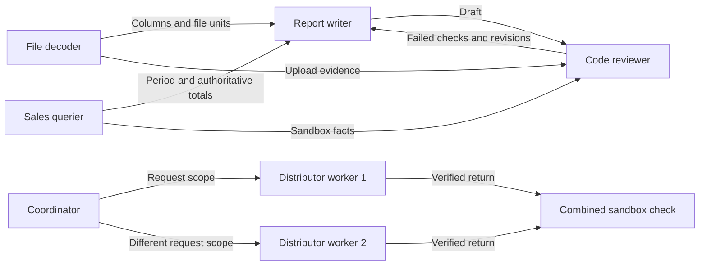

# 0006: Keep one agent for the sales analyst

Owner: Abraham. Decision date: 2026-11-20; finalized 2026-11-22. Status: **single-only on `main`**.
The integrated split experiment is preserved on `m2-split` at `m2-split-final`, including the real MCP,
policy, approval and recovery contracts. Its free correctness tests establish mechanisms only;
no matched-budget benefit has been established. See [integration evidence](../docs/milestones/M2-integration-evidence.json).

## What would have to cross between components?

The components considered are file decoder (D), sales querier (Q), report writer (W), reviewer (R),
and independent per-distributor batch workers (B). A frozen request ID, period and contact may be
passed at dispatch; the table distinguishes that from information needed while work is running.

| Pair | Information needed mid-task | How it would cross; consequence |
|---|---|---|
| D–Q | Neither needs the other's data to read an upload or the scoped sales table | Independent reads after dispatch; a coordinator combines them |
| D–W | Column mapping, units, row counts and corrections when interpretation fails | Structured handoff plus another decoder call if missing; a lossy return loses evidence |
| D–R | Whether figures attributed to the upload actually came from its parsed rows | Reviewer reads the same immutable upload; otherwise another handoff is required |
| D–B | A batch worker needs its own file interpretation before it can finish | Own-request handoff; splitting adds another context for a short read |
| Q–W | Current/previous totals and period; a discrepancy may need a second query | Structured facts through the coordinator, then a correction round if needed |
| Q–R | Authoritative totals and request scope to reject invented figures | Reviewer recomputes directly from the sandbox; no need to ask the query agent |
| Q–B | Each worker needs its distributor's totals | Scoped read result; a separate agent adds no new capability |
| W–R | Draft, check failures and revised draft | Repeated correction rounds; keep the code critic beside the writer |
| W–B | Each worker needs its own report/draft and IDs | Request-owned effects; do not share write authority between workers |
| R–B | Each worker needs a verified output before completion | Code checks the sandbox per request and again for the combined batch |
| B₁–B₂ | None for different requests, distributors and artifact namespaces | No messages or shared mutable records; duplicate request IDs must be refused |

## Gates, in order

Stop at the first failure; a later gate is not claimed to pass by default.

| Candidate component | Gate 1: little mid-task communication | Gate 2: independently checkable | Gate 3: cheaper capability unavailable to one agent | Gate 4: worth multiplier | Verdict |
|---|---|---|---|---|---|
| File decoder separated from writer | No for ambiguous columns: writer depends on interpretation and clarification before choosing its next step | Not reached | Not reached | Not reached | Keep together |
| Sales querier | Yes: request ID and period bind a read | Yes: recompute `sales.distributor_sales` | No: `query_sales` is already one bounded tool call; a separate model adds no parallel work | Not reached | Keep as a tool |
| Report writer separated from reviewer | No: check/revise cycles exchange the draft and failures | Not reached | Not reached | Not reached | Keep the code critic |
| Reviewer as another model | No for the same correction cycle | Not reached | Not reached | Not reached | Deterministic recomputation is cheaper and independently grounded |
| Per-distributor batch workers | Yes only for disjoint request IDs and artifacts | Yes: check each report/draft against its request, upload and sales rows | No demonstrated need: `tasks/batch_reports_two.yaml` has two short chains that the existing plan executor handles | Not reached | Single pending evidence |
| Read-only analyst → artifact writer experiment | No in the general case: an ambiguous upload or a discrepancy needs another analyst/writer correction round; the branch only proceeds with a frozen validated handoff | Not reached | Not reached | Not reached | Preserve the closest candidate at the experimental tag; exclude it from `main` |

The experiment's two roles have different **tool surfaces**: analyst gets `parse_file` and `query_sales`;
writer gets `render_chart`, `save_report` and `draft_report_email` for the selected request. The coordinator
owns the handoff and the combined end-state check. A prompt-only second reviewer would duplicate one model's
errors without an independent oracle, so it is rejected.

## Benefit and condition

The plausible benefit is context isolation: the writer receives checked facts instead of every upload row
and unsuccessful parse. It requires a compact return that carries all necessary evidence and IDs. What the
return cannot express is lost; it must explicitly report omitted searches and facts not determined. There
is no parallelism claim for the dependent analyst → writer chain. Distributor workers could save elapsed
time only on a larger batch of disjoint requests run concurrently; that is a different measured condition.

One agent can often obtain the same context benefit from a bounded tool result, notes, compaction and the
queryable session log. Splitting loses easy correction of an interpretation and adds coordination, return
validation and a shared-budget mechanism. Not splitting loses potential parallelism on a sufficiently
large independent batch and separately bounded contexts.

## Rejected alternative

**The analyst → writer split** (built on `m2-split`, preserved at `m2-split-final`) is the rejected alternative. It lost because it fails gate 1 in the general case (an ambiguous upload or a figure discrepancy needs another analyst/writer round), no pass has measured it beating one agent at the same budget, and its one plausible benefit, context isolation, is available to one agent more cheaply through bounded tool results, notes and the queryable session log. A **prompt-only second reviewer model** was also rejected: copies of one model do not fail independently, and the code critic recomputes figures from the sandbox.

## Assignment evidence and spend check

Source: `docs/assignment_refs.md`, Assignment 6, read 2026-11-20, copied by claudea from
[claudea24/agentic-ai-assignment6](https://github.com/claudea24/agentic-ai-assignment6) commit
`7013cb1ea4e3f9ba4ecea84fdabd97f81015135f`, `reports/LAB_06.md`, `LAB_06.json`, and
`results/runs_06.jsonl`. Model: `gemini-3.5-flash-lite`, not this project's `gpt-4o-mini`.
There were 72 runs, 24 per arm (18 single and 6 batch, three sweeps). These were the third measurements
after two split stopping-rule changes; the source records discarded earlier runs.

| Kind | Split/single mean-token multiplier | Original single | Split | Matched arm | Actual spend match |
|---|---|---|---|---|---|
| Single tasks | 0.70 (38,218 / 54,918) | 12/18 passed | 15/18 | 11/18 | Matched arm spent 28% less than split |
| Batches | 0.51 (182,138 / 357,222) | 4/6 passed | 0/6 | 1/6 | Matched arm spent 17% less than split |

The split did not spend more in either kind. Higher spend improved the single-agent batch result, but
the purported matched arm was not matched in actual spend. A single-task comparison within ±10% was
not measured. The numbers justify caution and the source's single-agent decision; they do not predict
a gain for this sales domain or establish equal-budget superiority here.

No published multi-agent performance claim is relied on for this decision. The lecture's reported
15×-chat multiplier is not used as a measurement of this project.

## Branch evidence and reopening condition

The branch must include a JSON-schema-validated return for every role, searched/not-searched fields and
spend computed from calls, one trace with parent IDs, a sandbox check of the combined end state, and one
150,000-token task allowance shared by all roles and the coordinator. A malformed return is rejected;
planted divergent state must fail even when each local result says success. No role waits on another:
the coordinator sequences them. Workers cannot write the same request; request scope is unique and every
write remains keyed in the common registry, with the run key in its logical identity. The combined checker uses captured per-run writer outputs rather than session-wide stamps; each claimed ID must appear in that writer’s successful ledger. Its chart contract is one current-revenue bar, and both stored values and the rendered SVG must match.

Build evidence: `tests/test_split.py` is preserved at `m2-split-final`. Its matrix runs all twelve official
task files through sandbox checks with `topology=split`; only batch reports use the split. Ordinary tasks
stay within 150,000 tokens; the four-task long session uses its 400,000-token session ceiling. Focused
tests cover malformed returns, boolean IDs, role surfaces, observed spend, budget exhaustion, exact
approvals, stopped-write resume and saved model responses. Corruption cases reject IDs absent from the
writer's ledger and edited reports/charts/SVGs. Further cases check distinct console-run effects,
approval-wait identity and operator additions across role transitions and a crash. The real MCP,
policy and checkpoint implementations are used with fake models. Neither a paid split comparison nor
a measured `m2-build` arm exists; free correctness does not demonstrate timing, quality or equal-spend benefit.

One local calculation per actual role surface on 2026-11-22 gives 310 estimated definition tokens for
the analyst (two tools) and 473 for the writer (three), using ceiling(serialized characters/4).
[Evidence](../docs/abraham-m2-test-evidence.json) records the tool names, character counts and hashes.
These estimates exclude role prompts, histories and repeated calls; they are not a provider-metered
bill or evidence that split saves total tokens.

Reopen only with at least eight independent distributor requests whose selected inputs exceed one
configured context budget, with a per-request sandbox oracle and a combined check. Run single and split
on identical tasks, model, tools and evaluator, three sweeps, at the same enforced total task allowance.
Report actual tokens, success per sweep and wall-clock time. Merge only if the gates pass, every safety
test passes, actual spend is comparable (predeclare ±10%), and the split improves checked success or
reduces median latency by at least 20% without lowering checked success. These thresholds are a proposed
decision rule, not a measured result.
