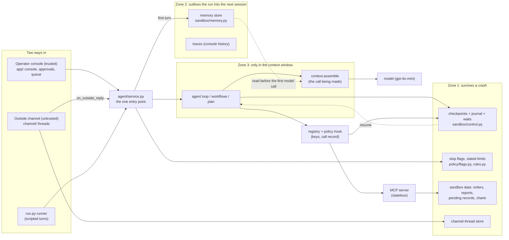

# Milestone 2: Data analyst

> SKELETON (setup, Nov 20). Every heading names its owner. Write only your own sections; anything from another
> member's part is a placeholder (`[abraham: ...]`, `[myron: ...]`, `[claudea: ...]`, `[run: ...]`, `[A4: ...]`)
> until after the merge. Every number gives its source, read date and run count. Assignment numbers come only
> from `docs/assignment_refs.md`. Parts 1 to 3 and the team: about 2,500 words; tables, the diagram, the sketch
> and the appendix do not count.

## Build table

Owners: **claudea** checkpoints/resume/memory/disclosure; **abraham** outside exchange/context/stop/mid-task/split;
**myron** MCP/deferred loading/code calls/policy/approvals/escalation. One row per piece this milestone builds; the
evidence must run (a test, a trace or a command).

| Piece | Owner | Where in the code | Evidence |
|---|---|---|---|
| Checkpoints and the resume | claudea | `agent/checkpoints.py` (placement, modes, journal), `agent/runs.py` (resume, crashed), `sandbox/control.py`, `agent/workflows.py` | `tests/test_recovery.py` (kill -9 during the last write on every task that writes), `tests/test_checkpoints.py`, `tests/test_m2_contracts.py` |
| The three exits, irreversible steps last | claudea | `agent/exits.py`, `agent/compensations.py`, `agent/workflows.py` (`_three_exits`, `_compensate_completed`), `sandbox/reports.py` `withdraw`, `sandbox/charts.py` `delete` | `tests/test_checkpoints.py` (ThreeExitsTest, CompensationsTest) |
| The MCP server | myron | `mcp_server/` | [myron: tests/test_mcp.py] |
| Deferred loading and code calls | myron | `mcp_server/`, `agent/code_calls.py` | [myron: tests/test_deferred.py, tests/test_code_calls.py] |
| The outside exchange and its wait | abraham | `agent/outside.py`, `agent/service.py` | [abraham: tests/test_outside.py] |
| Context assembly | abraham | `agent/context.py` | [abraham: tests/test_context.py] |
| Notes and compaction | abraham | `agent/notes.py`, `agent/context.py` | [abraham: tests/test_context.py, tasks/sessions/] |
| The memory store and the later session | claudea | `agent/memory.py` (write policy, read), `sandbox/memory.py`, `sandbox/seed.py` (`memory:`), `tasks/memory_subject_preference.yaml`, `checks/memory_preference.py` | `tests/test_memory.py` (three sessions, each its own process); `make serve` later session in the app |
| The policy and the hook | myron | `policy/autonomy.yaml`, `policy/hook.py`, `policy/limits.py` | [myron: tests/test_hook.py] |
| The approval gate and the queue page | myron | `agent/approvals.py`, `sandbox/queue.py` | [myron: tests/test_approval.py] |
| The escalation | myron | `agent/escalation.py` | [myron: tests/test_escalation.py] |
| The stop and its three commands | abraham | `agent/stop.py`, `policy/flags.py` | [abraham: tests/test_stop.py] |
| Messages mid-task | abraham | `agent/messages.py` | [abraham: tests/test_midtask.py] |
| The disclosure | claudea | `agent/disclosure.py`, `policy/hook.py`, `checks/helpers.py` | `tests/test_disclosure.py`, `tests/test_m2_contracts.py` (DisclosureInChecksTest, the registry refusal) |
| The split on its branch | abraham | branch `m2-split` | [abraham: tests/test_split.py] |

## Decision table

Milestone 1's rows and columns carry on (see `docs/milestones/M1.md`); this milestone adds the columns below and
the rows each owner fills. Show one of each way where the handout asks: a place where it helps, which you build,
and one where it does not, each argued by the lecture's test.

| Row | Checkpoint (claudea) | Durability mode (claudea) | Code calls (myron) | Loading (myron) | Ask the stranger (abraham) | Notes / compaction (abraham) | Memory (claudea) | Autonomy column (myron) | Approval mode (myron) | Escalation signal (myron) | Topology (abraham) |
|---|---|---|---|---|---|---|---|---|---|---|---|
| [each use case, action class, kind of session, kind of fact and component] | | | | | | | | | | | |
| standard_report (workflow) | no before 3 render_chart / 4 save_report (keyed, args fixed by code); **yes** before 6 draft_report_email (args from model calls too costly to repeat) (L4 s.11, 13) | async: only keyed, reversible writes (L4 s.12) | | | | | | | | | |
| out_of_scope (workflow) | no: one keyed write from a fixed template | async | | | | | | | | | |
| status_question (workflow) | no: reads only | exit: only answers the operator | | | | | | | | | |
| messy_file, compare_check (agent) | **yes**, every model round: the model writes the arguments, a replay could write others (L4 s.13) | sync: may reach the irreversible send | | | | | | | | | |
| batch_reports (plan) | [abraham: plan step checkpoints] | sync | | | | | | | | | |
| save_report / render_chart / draft_report_email / draft_clarifying_question (writes) | keyed; compensation: withdraw report / delete chart / discard pending (L3 s.41) | | | | | | | | | | |
| send_report_email (write) | keyed; irreversible, last on every path; no compensation (L3 s.41) | sync | | | | | | | | | |
| fact: operator's stated preference (semantic) | | | | | | | **kept**: stated, not derivable, else re-asked (L4 s.23); `memory.preferences` on | | | | |
| fact: operator's standing rule (procedural) | | | | | | | **kept**: stated (L4 s.23); `memory.standing_rules` on | | | | |
| fact: anything the sandbox holds (revenue, reports, status) | | | | | | | **not kept**: read fresh from the sandbox; a copy goes stale (L4 s.23, 25) | | | | |
| fact: a stranger's text | | | | | | | **not kept**: never stored; would be memory poisoning (L4 s.24) | | | | |

## Part 1: State, the outside exchange and memory

### The durability boundary (claudea)

What carries within a run, between runs, and across a crash (slides 6, 7); what must outlive the run lives in a
store or a checkpoint, never only in the window (slide 30).

| What the system knows | Within a run | Between runs (the operator's next session) | Across a crash or a restart |
|---|---|---|---|
| The operator's current request | the context window, whole in every call | not needed: a new request starts a new run | the run's checkpoint (`operator_text`) |
| The plan and each step's status | the run's state | not needed | the checkpoint and the journal (`sandbox/control.py`) |
| Completed writes and their results | the run's state | the sandbox (reports, pending records) | the journal, and the key on every write |
| A stranger's reply | the context, labelled as the stranger's | the channel's thread store | the thread store, and the wait in the checkpoint |
| A limit the operator stated | a rule (`policy/rules.py`) | the rule, for the session | the rule, in `sandbox/control.py` |
| What the operator said last week (a preference, a standing rule) | read at the session's start | the memory store (`sandbox/memory.py`) | the memory store |
| The model's reasoning so far | the context window only | lost, by design | lost; a resume replays from the checkpoint |

Zone 1 is reset by `make app` and every run.py run and kept by `make serve`; zone 3 is rebuilt from zone 1 on a resume.

### Checkpoints, and writes whose outcome is unknown (claudea)

Every write is keyed by the registry. A checkpoint goes where replaying would repeat an effect no key closes, or
redo work too costly to repeat (slides 11, 13; `checkpoints.needs_checkpoint`):

| Path | Step | Mark | Checkpoint before it? | Why (slides 11, 13) |
|---|---|---|---|---|
| standard_report (workflow) | 1 parse_file, 2 query_sales | read | no | safe to repeat; the journal keeps the result anyway |
| | 3 render_chart, 4 save_report | keyed write, args fixed by code | **no** | the key is the step id: a replay gets the first result back |
| | 5 draft + critique (model calls) | no effect | n/a | |
| | 6 draft_report_email | keyed write, args from model calls | **yes** | after a read too costly to repeat: a resume reuses the passed draft, no model calls |
| out_of_scope (workflow) | 1 draft_clarifying_question (fixed template) | keyed write, args fixed by code | no | key from the step id |
| status_question (workflow) | records | read | no | |
| agent loop (messy_file, compare_check) | every model round | — | **yes** | the model writes the next call's arguments; on a replay it may write others, a new key, a second effect. So the conversation is saved before each round and a resume replays from it |
| | parse_file, query_sales | read | (round's) | |
| | render_chart, save_report, draft_report_email | keyed write, args from the model | (round's) | key from `key_fields`; the saved round fixes the arguments |
| batch_reports (plan) | each plan step | keyed by plan step id | [abraham: plan checkpoint] | |
| waits (outside reply, approval, escalation, stop) | the pause | — | yes | `checkpoints.set_wait`: the run waits on disk, not in a process |

**One of each:** the agent loop's email draft **needs** one (the model writes its recipient and report ID; a replay
could write others: a new key, a second effect); the workflow's `save_report` **does not** (code fixed its arguments,
its key is its step id).

| Kind of run | Durability mode (slide 12) | Why |
|---|---|---|
| agent path (messy_file, compare_check, batch_reports) | sync | can reach the irreversible `send_report_email` |
| standard_report, out_of_scope | async | only keyed, reversible writes: a crash loses at most the step in flight, its key closes it |
| status_question (answers the operator) | exit | reads only: a crash loses the answer, asked again next turn |

| A checkpoint holds (slide 14) | |
|---|---|
| always | path, request, use case, current step, completed calls with keys and results (the journal), what it waits for |
| workflow step 6 | the email arguments that passed the critique |
| agent path | the conversation, whole: one run is one request, bounded by the step limit (a console session's earlier turns are in its trace, not the run's checkpoint) |
| keyed by | the run: run.py's run ID, or `"<session>#<run number>"` in the app, on SQLite; the last checkpoint goes into the trace at the run's end |

| Waiting run | What resumes it (`runs.resume`) |
|---|---|
| a stranger's question | the reply, through `on_outside_reply` |
| a gated call | the operator's answer, `decide_approval` |
| a stop | the operator's `/resume` |
| an escalation | the operator's answer, in any later session |
| a crash | the operator's next turn (`runs.crashed`) [abraham: the service's call]; nothing resumes at start-up |

On a resume, a finished step or keyed write comes back from the journal; the step in flight replays with its saved
arguments (coordinators decide, steps act: slide 15).

| A write failed or timed out (L3 slide 40; `agent/exits.py`) | Read the sandbox: did it happen? |
|---|---|
| yes | carry on with the existing result |
| no | retry once under the same key |
| cannot tell | escalate to **the operator** (`unsettled_write`), end the run, write nothing more |

**Irreversible steps last** (slide 41): `send_report_email` comes after the report and its draft on every path; a
write that fails for good after others succeeded compensates them newest first (`agent/compensations.py`).

**The recovery test** (`tests/test_recovery.py`; fake model, one run per task, 2026-11-21) kills the process with
SIGKILL after the sandbox commits each task's last write and before the registry records it, then resumes in a new
process: the check passes, one effect per write, and only the in-flight write ran again. Rows stamped with the
run's ID (reports, pending, charts), joining M1's "Did the effect happen?" table:

| Task | Before the run | After the crash | After the resume | What the resume ran |
|---|---|---|---|---|
| standard_report_clean | 0 reports, 0 pending, 0 charts | 1, 1, 1 | 1, 1, 1 | the email step only, from its saved draft (no model call) |
| out_of_scope_margins | 0, 0, 0 | 0, 1, 0 | 0, 1, 0 | the decline only (the sandbox returned the first record) |
| messy_file_semicolon | 0, 0, 0 | 1, 1, 1 | 1, 1, 1 | the email draft only |
| compare_check_last_quarter | 0, 0, 0 | 1, 1, 1 | 1, 1, 1 | the email draft only |
| memory_subject_preference | 0, 0, 0 | 1, 1, 1 | 1, 1, 1 | the email step only |
| [abraham: the tasks added at the merge, T2c] | | | | |

**Assignment 4** (claudea's, `docs/assignment_refs.md`, `gemini-3.5-flash-lite`, read 2026-11-20): killed at each of
10 steps, derived keys left **0/10** duplicates; random keys **2/10**, both at the last write. So every key here comes
from the effect's identity, and the test kills during the last write.

### The MCP server (myron)

[myron: M1 to M2. The SDK, its version and revision, with the date checked; the strict-mode request and the
vendor's answer.]

### A tool list that does not crowd the window (myron)

[myron: M3. The bill per call and per run, per agent; the fixes in slide 28's order; the loading switch's reason;
a use case where code calls the tools and one where it does not.]

### The outside exchange, and a wait that survives a restart (abraham)

[abraham: B1 to B2. A use case that asks and one that does not; the wait's deadline; how the reply is labelled.]

### Context, within a budget (abraham)

[abraham: B3 to B4. The budget, the rule, the threshold, what the notes hold; long context or retrieval per large
input; a kind of session that needs notes and compaction and one that does not; A2 cited.]

### Memory with provenance, and the operator's later session (claudea)

| Kind of fact (slides 18, 23) | Kept? | Why |
|---|---|---|
| the operator's stated preference (semantic; such as a subject prefix on every report email) | **kept** (`memory.preferences`) | stated, not derivable from any record; else asked again every session |
| the operator's standing rule (procedural; "from now on, always ...") | **kept** (`memory.standing_rules`) | stated by the trusted operator |
| anything the sandbox holds (revenue, last quarter's report, a request's status) | **not kept** | read fresh from the sandbox; a copy could only go stale |
| a stranger's text | **not kept** | it would come back as our own knowledge: memory poisoning (slide 24) |

| Write policy (slide 23; `memory.write`, the one place) | |
|---|---|
| how | insert a new name; merge a repeat; a new value supersedes the old, both kept, with timestamps and which replaced which |
| with | provenance on every record: source, written_at, derived_or_ingested, confirmed |
| when | at a run's end (`runs.end`), from the operator's own lines, by code; never mid-run on a guess |

| Failure it invites (slide 25) | Answer |
|---|---|
| stale | every record shows its age; unread for 180 days, it expires when next read |
| contradictory | supersede, never append a rival |
| unbounded | 200 records at most; superseded first, then least recently read |

**Lifetime:** one of 8 test tasks states a fact; at about 2 stated facts a day [run: Part 4's rate], 200 records
last about 100 days before eviction starts.

**The later session.** After `make serve` the console lists the earlier sessions with their history. A new session
reads the store and the waiting runs **before its first model call**, logs the read (`memory_read`: each record's
id, age, source) and shows the operator each one ("Remembered (2 days old, from the operator): ..."). The read takes
the kept kinds whose switch is on, newest first, within a token budget; the model sees only what assembly puts in
(slide 20). A record can be lost when **written** (a fact in a turn that ends with no run waits for the next run's
end), **stored** (evicted), **searched for** (expired, over budget) or **used** (not attended to; the subject
prefix is applied by code, so it cannot be). Evidence: `tests/test_memory.py` (three sessions, each its own
process), the app served, stopped and served again, and `tasks/memory_subject_preference.yaml`.

### The orchestration abstraction (claudea)

| Question | Answer here | Piece |
|---|---|---|
| Do you know the steps and their order in advance? | for the workflows and a validated batch plan, yes; for the agent path, no | a graph (workflow code, the plan's dependency order) for those; an event-driven loop, the model choosing the next tool, for the agent path |
| Do runs outlive a single process? | yes: a run waits days for a stranger or an approval, and console sessions survive a restart | checkpoints on disk (`sandbox/control.py`) |
| Do steps have irreversible side effects? | yes: an emailed report cannot be recalled | a key on every write; durable execution only if a half-done run must finish on its own, which ours need not |
| Do you want to write the loop and compaction yourself? | yes | our own harness; the context decisions are ours either way |

Durable execution is a checkpoint, a journal and a supervisor (slide 37): we have the first two, **no supervisor**.
Slide 40: does it notice a run died? **No.** Restart it without a person? **No.** Stop finished work being done
twice? **Yes** (journal, keys). **A recovery aid, not a guarantee;** the operator fills the gap: their next turn
resumes a crashed run.

### "Which boundary lost it?" (claudea; rows from abraham and myron)

Boundaries (slide 34, the context split as in Assignment 4's Part F): attention, compaction, the session, a restart.

| Fact | Boundary that could lose it | What holds it across |
|---|---|---|
| The operator's current request | compaction (a long session) | kept whole in every call [abraham: assembly rule]; the checkpoint's `operator_text` across a restart |
| Each step's status and the completed calls | restart | the checkpoint and the journal; keys on every write |
| The plan as validated | restart | [abraham: plan checkpoint] |
| A stranger's reply | restart | the channel's thread store and the wait in the checkpoint |
| A stranger's reply, later in a long session | compaction | [abraham: notes hold its IDs and status, never its words] |
| A limit the operator stated ("send nothing until I have read it") | compaction, session | a rule the hook reads (`policy/rules.py`), never only text in the chat |
| A preference or standing rule stated in an earlier session | session | the memory store, read before the first model call |
| The same, read but not attended to | attention | shown to the operator; a preference applied by code (the subject prefix) |
| A gated call waiting for the operator | restart | [myron: the approval store] |
| A run held by an escalation | restart | the checkpoint's `held`, and the queue |

Assignment 4 (`docs/assignment_refs.md`): attention, compaction and session each lost its fact and its fix restored
it, 3/3; the restart held across all 10 kill points. **Gaps:** a fact stated in a turn that ends with no run waits
for the next run's end; a batch run killed mid-plan cannot resume until abraham's plan checkpoint; no supervisor.
[Part 4: results and run counts on rows a pass measured.]

## Part 2: Autonomy, approvals and the stop

### Rank every action (myron)

[myron: M4. One row per action and circumstance: undo path, would anyone notice, blast radius, column; tools
removed or narrowed.]

### The policy in three columns, and the hook (myron)

[myron: M5. The three columns; a class that runs alone and one that asks; the prohibited column.]

### The approval gate and the queue page (myron)

[myron: M6. At the plan and per action, each argued; what still checks each step's output; when the plan review
is asked; A5 cited.]

### The escalation (myron)

[myron: M7. The signals and the use cases each covers; one covered and one not; the packet, the hold, the cap.]

### The stop (abraham)

[abraham: B5. The five-condition table; the condition met only partly; cancel, resume and rollback told apart.]

### Messages mid-task (abraham)

[abraham: B6. The way each kind of message takes; the queue's bound.]

### Tell the stranger an agent wrote it (claudea)

| Question (slides 42 to 44, 47) | Answer for this system |
|---|---|
| EU AI Act: what is it used for? | reporting a distributor's own sales back to it: not a banned practice, not an Annex III high-risk use (it decides nothing about a person); a real deployment's status is counsel's call |
| EU AI Act: does it talk with people or make content? | yes: it writes to distributors' contacts, so Article 50 applies from 2 August 2026; being an AI is not obvious in an email thread |
| Colorado's, California's human-review rules | reach consequential decisions about people (hiring, lending, housing); ours makes none, so neither reaches it as built |

The line is added in code (`agent/disclosure.py`), never by a prompt: *"This message was written by an automated
agent for the sales analytics team. To reach a person, reply to this thread with "human" and an analyst will
answer."* Every send passes `with_disclosure` before the registry, so the approval dry run shows it; the hook
refuses a send without it and logs the refusal (`hook_decision` deny; `tool_call` outcome `denied`); every task's
check fails an agent message without it. The operator's own hand-sent mail carries none. Evidence:
`tests/test_disclosure.py`, `tests/test_m2_contracts.py`.

### "Who is going to read this, and will they?" (myron)

[myron: M8. A row per approval point, the escalation, the stop's notice and the stranger; the asks on a real day;
seconds per ask; the rate by class; the shortcuts the screens invite; the three frameworks and what the tier owes.]

## Part 3: The topology (abraham)

[abraham: B7 to B9. "Would these ever need to talk mid-task?" for every two components, and the sketch; the gates
per component with evidence; the benefit and its condition; A6 cited; a link to `decisions/0006-topology.md`.]

## Part 4: The passes (myron: runs and ledger; abraham: first failures; claudea: recompute)

### The build's runs: the first thing that went wrong (abraham)

| Run ID | Task | First thing that went wrong (the lectures' words) | Trace line |
|---|---|---|---|
| [run: ...] | | | |

### The table of passes (myron)

| Pass | Problem and evidence | Lecture's test and its answer | Prediction | Before → after (counts) | Verdict and switch now | Entry |
|---|---|---|---|---|---|---|
| [myron: Pass 2] | | | | | | |
| [myron: Pass 3] | | | | | | |

## The team

[claudea: F3. Who owns what, by role and name: the parts of the system, each pass, the report sections.]

## AI assistance

[claudea: F3. One line: which tool, what it wrote, and what you checked.]

## Appendix: approval screens (myron)

[myron: M6. One screen per gated action class, as the approvals page shows it, each line marked computed or
asserted.]
