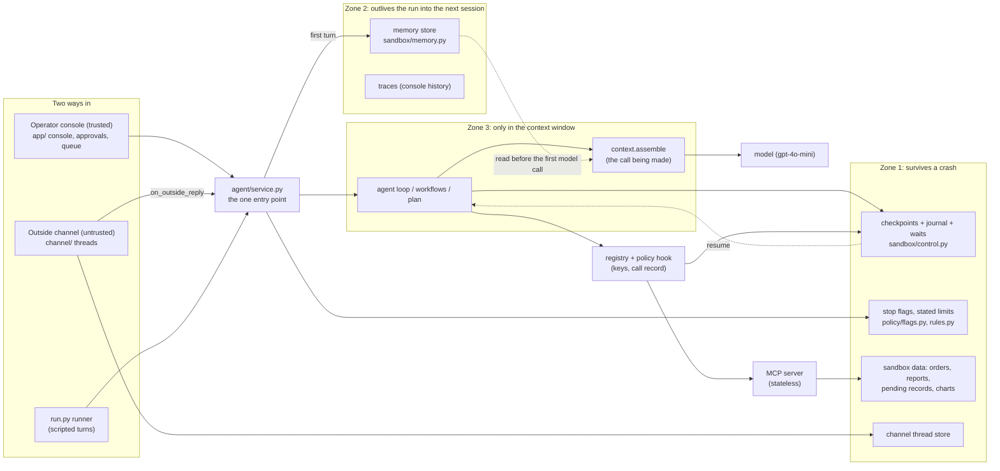

# Milestone 2: Data analyst

> SKELETON (setup, Nov 20). Every heading names its owner. Write only your own sections; anything from another
> member's part is a placeholder (`[abraham: ...]`, `[myron: ...]`, `[claudea: ...]`, `[run: ...]`, `[A4: ...]`)
> until after the merge. Every number gives its source, read date and run count. Assignment numbers come only
> from `docs/assignment_refs.md`. Parts 1 to 3 and the team: about 2,500 words; tables, the diagram, the sketch
> and the appendix do not count.

## Build table

Owners: **claudea** checkpoints/resume/memory/disclosure; **abraham** outside exchange/context/stop/mid-task/split;
**myron** MCP/deferred loading/code calls/policy/approvals/escalation. One row per piece this milestone builds; the
evidence must run (a test, a trace or a command).

| Piece | Owner | Where in the code | Evidence |
|---|---|---|---|
| Checkpoints and the resume | claudea | `agent/checkpoints.py` (placement, modes, journal), `agent/runs.py` (resume, crashed), `sandbox/control.py`, `agent/workflows.py` | `tests/test_recovery.py` (kill -9 during the last write on every task that writes), `tests/test_checkpoints.py`, `tests/test_m2_contracts.py` |
| The three exits, irreversible steps last | claudea | `agent/exits.py`, `agent/compensations.py`, `agent/workflows.py` (`_three_exits`, `_compensate_completed`), `sandbox/reports.py` `withdraw`, `sandbox/charts.py` `delete` | `tests/test_checkpoints.py` (ThreeExitsTest, CompensationsTest) |
| The MCP server | myron | `mcp_server/`, `agent/registry.py`, `agent/tools.py` | `tests/test_mcp.py`; `scripts/strict_request.py` |
| Deferred loading and code calls | myron | `agent/registry.py` (loading), `agent/tools.py` (`search_tools`), `agent/code_calls.py` | `tests/test_deferred.py`, `tests/test_code_calls.py` |
| The outside exchange and its wait | abraham | `agent/outside.py`, `agent/service.py` | [abraham: tests/test_outside.py] |
| Context assembly | abraham | `agent/context.py` | [abraham: tests/test_context.py] |
| Notes and compaction | abraham | `agent/notes.py`, `agent/context.py` | [abraham: tests/test_context.py, tasks/sessions/] |
| The memory store and the later session | claudea | `agent/memory.py` (write policy, read), `sandbox/memory.py`, `sandbox/seed.py` (`memory:`), `tasks/memory_subject_preference.yaml`, `checks/memory_preference.py` | `tests/test_memory.py` (three sessions, each its own process); `make serve` later session in the app |
| The policy and the hook | myron | `policy/autonomy.yaml`, `policy/hook.py`, `policy/limits.py`, `policy/rules.py` | `tests/test_hook.py` |
| The approval gate and the queue page | myron | `agent/approvals.py`, `sandbox/queue.py`, `app/templates/approvals.html`, `queue.html` | `tests/test_approval.py` (incl. `tasks/approval_send_*.yaml` end to end), `tests/test_queue.py` |
| The escalation | myron | `agent/escalation.py`, `policy/autonomy.yaml` (`escalate`, `budget`) | `tests/test_escalation.py`; `tasks/escalation_conflicting_figure.yaml` |
| The stop and its three commands | abraham | `agent/stop.py`, `policy/flags.py` | [abraham: tests/test_stop.py] |
| Messages mid-task | abraham | `agent/messages.py` | [abraham: tests/test_midtask.py] |
| The disclosure | claudea | `agent/disclosure.py`, `policy/hook.py`, `checks/helpers.py` | `tests/test_disclosure.py`, `tests/test_m2_contracts.py` (DisclosureInChecksTest, the registry refusal) |
| The split on its branch | abraham | branch `m2-split` | [abraham: tests/test_split.py] |

## Decision table

Milestone 1's rows and columns carry on (see `docs/milestones/M1.md`); this milestone adds the columns below and
the rows each owner fills. Show one of each way where the handout asks: a place where it helps, which you build,
and one where it does not, each argued by the lecture's test.

| Row | Checkpoint (claudea) | Durability mode (claudea) | Code calls (myron) | Loading (myron) | Ask the stranger (abraham) | Notes / compaction (abraham) | Memory (claudea) | Autonomy column (myron) | Approval mode (myron) | Escalation signal (myron) | Topology (abraham) |
|---|---|---|---|---|---|---|---|---|---|---|---|
| [each use case, action class, kind of session, kind of fact and component] | | | | | | | | | | | |
| standard_report (workflow) | no before 3 render_chart / 4 save_report (keyed, args fixed by code); **yes** before 6 draft_report_email (args from model calls too costly to repeat) (L4 s.11, 13) | async: only keyed, reversible writes (L4 s.12) | | | | | | | | | |
| out_of_scope (workflow) | no: one keyed write from a fixed template | async | | | | | | | | | |
| status_question (workflow) | no: reads only | exit: only answers the operator | | | | | | | | | |
| messy_file, compare_check (agent) | **yes**, every model round: the model writes the arguments, a replay could write others (L4 s.13) | sync: may reach the irreversible send | | | | | | | | | |
| batch_reports (plan) | [abraham: plan step checkpoints] | sync | | | | | | | | | |
| save_report / render_chart / draft_report_email / draft_clarifying_question (writes) | keyed; compensation: withdraw report / delete chart / discard pending (L3 s.41) | | | | | | | | | | |
| send_report_email (write) | keyed; irreversible, last on every path; no compensation (L3 s.41) | sync | | | | | | | | | |
| fact: operator's stated preference (semantic) | | | | | | | **kept**: stated, not derivable, else re-asked (L4 s.23); `memory.preferences` on | | | | |
| fact: operator's standing rule (procedural) | | | | | | | **kept**: stated (L4 s.23); `memory.standing_rules` on | | | | |
| fact: anything the sandbox holds (revenue, reports, status) | | | | | | | **not kept**: read fresh from the sandbox; a copy goes stale (L4 s.23, 25) | | | | |
| fact: a stranger's text | | | | | | | **not kept**: never stored; would be memory poisoning (L4 s.24) | | | | |

## Part 1: State, the outside exchange and memory

### The durability boundary (claudea)

What carries within a run, between runs, and across a crash (slides 6, 7); what must outlive the run lives in a
store or a checkpoint, never only in the window (slide 30).

| What the system knows | Within a run | Between runs (the operator's next session) | Across a crash or a restart |
|---|---|---|---|
| The operator's current request | the context window, whole in every call | not needed: a new request starts a new run | the run's checkpoint (`operator_text`) |
| The plan and each step's status | the run's state | not needed | the checkpoint and the journal (`sandbox/control.py`) |
| Completed writes and their results | the run's state | the sandbox (reports, pending records) | the journal, and the key on every write |
| A stranger's reply | the context, labelled as the stranger's | the channel's thread store | the thread store, and the wait in the checkpoint |
| A limit the operator stated | a rule (`policy/rules.py`) | the rule, for the session | the rule, in `sandbox/control.py` |
| What the operator said last week (a preference, a standing rule) | read at the session's start | the memory store (`sandbox/memory.py`) | the memory store |
| The model's reasoning so far | the context window only | lost, by design | lost; a resume replays from the checkpoint |

Zone 1 is reset by `make app` and every run.py run and kept by `make serve`; zone 3 is rebuilt from zone 1 on a resume.

### Checkpoints, and writes whose outcome is unknown (claudea)

Every write is keyed by the registry. A checkpoint goes where replaying would repeat an effect no key closes, or
redo work too costly to repeat (slides 11, 13; `checkpoints.needs_checkpoint`):

| Path | Step | Mark | Checkpoint before it? | Why (slides 11, 13) |
|---|---|---|---|---|
| standard_report (workflow) | 1 parse_file, 2 query_sales | read | no | safe to repeat; the journal keeps the result anyway |
| | 3 render_chart, 4 save_report | keyed write, args fixed by code | **no** | the key is the step id: a replay gets the first result back |
| | 5 draft + critique (model calls) | no effect | n/a | |
| | 6 draft_report_email | keyed write, args from model calls | **yes** | after a read too costly to repeat: a resume reuses the passed draft, no model calls |
| out_of_scope (workflow) | 1 draft_clarifying_question (fixed template) | keyed write, args fixed by code | no | key from the step id |
| status_question (workflow) | records | read | no | |
| agent loop (messy_file, compare_check) | every model round | — | **yes** | the model writes the next call's arguments; on a replay it may write others, a new key, a second effect. So the conversation is saved before each round and a resume replays from it |
| | parse_file, query_sales | read | (round's) | |
| | render_chart, save_report, draft_report_email | keyed write, args from the model | (round's) | key from `key_fields`; the saved round fixes the arguments |
| batch_reports (plan) | each plan step | keyed by plan step id | [abraham: plan checkpoint] | |
| waits (outside reply, approval, escalation, stop) | the pause | — | yes | `checkpoints.set_wait`: the run waits on disk, not in a process |

**One of each:** the agent loop's email draft **needs** one (the model writes its recipient and report ID; a replay
could write others: a new key, a second effect); the workflow's `save_report` **does not** (code fixed its arguments,
its key is its step id).

| Kind of run | Durability mode (slide 12) | Why |
|---|---|---|
| agent path (messy_file, compare_check, batch_reports) | sync | can reach the irreversible `send_report_email` |
| standard_report, out_of_scope | async | only keyed, reversible writes: a crash loses at most the step in flight, its key closes it |
| status_question (answers the operator) | exit | reads only: a crash loses the answer, asked again next turn |

| A checkpoint holds (slide 14) | |
|---|---|
| always | path, request, use case, current step, completed calls with keys and results (the journal), what it waits for |
| workflow step 6 | the email arguments that passed the critique |
| agent path | the conversation, whole: one run is one request, bounded by the step limit (a console session's earlier turns are in its trace, not the run's checkpoint) |
| keyed by | the run: run.py's run ID, or `"<session>#<run number>"` in the app, on SQLite; the last checkpoint goes into the trace at the run's end |

| Waiting run | What resumes it (`runs.resume`) |
|---|---|
| a stranger's question | the reply, through `on_outside_reply` |
| a gated call | the operator's answer, `decide_approval` |
| a stop | the operator's `/resume` |
| an escalation | the operator's answer, in any later session |
| a crash | the operator's next turn (`runs.crashed`) [abraham: the service's call]; nothing resumes at start-up |

On a resume, a finished step or keyed write comes back from the journal; the step in flight replays with its saved
arguments (coordinators decide, steps act: slide 15).

| A write failed or timed out (L3 slide 40; `agent/exits.py`) | Read the sandbox: did it happen? |
|---|---|
| yes | carry on with the existing result |
| no | retry once under the same key |
| cannot tell | escalate to **the operator** (`unsettled_write`), end the run, write nothing more |

**Irreversible steps last** (slide 41): `send_report_email` comes after the report and its draft on every path; a
write that fails for good after others succeeded compensates them newest first (`agent/compensations.py`).

**The recovery test** (`tests/test_recovery.py`; fake model, one run per task, 2026-11-21) kills the process with
SIGKILL after the sandbox commits each task's last write and before the registry records it, then resumes in a new
process: the check passes, one effect per write, and only the in-flight write ran again. Rows stamped with the
run's ID (reports, pending, charts), joining M1's "Did the effect happen?" table:

| Task | Before the run | After the crash | After the resume | What the resume ran |
|---|---|---|---|---|
| standard_report_clean | 0 reports, 0 pending, 0 charts | 1, 1, 1 | 1, 1, 1 | the email step only, from its saved draft (no model call) |
| out_of_scope_margins | 0, 0, 0 | 0, 1, 0 | 0, 1, 0 | the decline only (the sandbox returned the first record) |
| messy_file_semicolon | 0, 0, 0 | 1, 1, 1 | 1, 1, 1 | the email draft only |
| compare_check_last_quarter | 0, 0, 0 | 1, 1, 1 | 1, 1, 1 | the email draft only |
| memory_subject_preference | 0, 0, 0 | 1, 1, 1 | 1, 1, 1 | the email step only |
| [abraham: the tasks added at the merge, T2c] | | | | |

**Assignment 4** (claudea's, `docs/assignment_refs.md`, `gemini-3.5-flash-lite`, read 2026-11-20): killed at each of
10 steps, derived keys left **0/10** duplicates; random keys **2/10**, both at the last write. So every key here comes
from the effect's identity, and the test kills during the last write.

### The MCP server (myron)

*Owner: myron.* The tools are served by our own MCP server (`mcp_server/`), built on the official Python SDK
`mcp` **2.3.0**, which implements protocol revision **2026-07-28**, the stateless one (checked 2026-11-20 on
PyPI and in the SDK's `LATEST_PROTOCOL_VERSION`). Every request carries its own envelope in `params._meta`;
there is no `initialize` and no session. The SDK still accepts the old handshake from old clients, but our
client never sends it, and we use none of Roots, Sampling or Logging. The registry's process starts the
server as a child (`mcp_server/client.py`) on the first tool call, so `make app` and `run.py` need nothing
more. A dead server is started again on the next call, which works because nothing a call needs lives in
the server.

The registry stays in our code in front of every call: it validates, derives the write key, asks the hook,
and records the call, and only then sends `tools/call`. The model never sees the key. Each call's `_meta`
carries the IDs it needs: the request, the run or console session that stamps its writes, the state folder,
and the key. Results return the next IDs (`report_id`, `pending_id`, `thread_id`). The sandbox accepts each
key once (UNIQUE key columns), and `tools/list` returns the catalogue in the registry's fixed order.

Errors come back in two classes. An execution error returns `isError: true` with a failure class (transient,
ambiguous, permanent), which the registry routes as in Milestone 1. A protocol error (unknown tool, missing
context) is a JSON-RPC error, which the registry turns into `protocol_error`. A lost stream on a write is an
unknown outcome (`ambiguous_write`), never a blind retry. `run_program` is the one tool that runs in the
registry's process; every call its program makes still goes through the registry to the server.

**Strict mode as sent.** `scripts/strict_request.py` sends one request with the five strict definitions
(`query_sales`, `ask_stranger`, `send_report_email`, `search_tools`, `run_program`) exactly as the registry
sends them, and keeps OpenAI's answer in `experiments/evidence/strict_request.json`.
**OpenAI accepted all five** (2026-11-21 03:13 UTC; served by gpt-4o-mini-2024-07-18; one request). An
earlier attempt from a shell with a different key environment got HTTP 400 with no message kept. It was not
reproduced: the request was the same, and the retry through `scripts/with_env.py` was accepted.
`parse_file` stays non-strict because its two arguments are optional.

### A tool list that does not crowd the window (myron)

*Owner: myron.* **The bill** (Lecture 3, slide 23). Milestone 1 measured the six rewritten definitions at
**551 input tokens per call** (`experiments/evidence/definition_cost_final.json`, gpt-4o-mini-2024-07-18,
2026-10-31, one with/without pair). Only agent-path calls carry definitions: the M1 baseline made
**4.67 `agent_step` calls per agent run** (28 calls over 6 runs: compare_check 4.33, messy_file 5.00;
`results/baseline/`, 18 runs). That is about **2,570 definition tokens per agent run** in Milestone 1.

Milestone 2's list is 8 definitions with `tools.loading=all`, measured at **715 input tokens per call**
(`experiments/evidence/definition_cost_m2.json`, gpt-4o-mini-2024-07-18, 2026-11-21, one with/without pair
per surface). At M1's call rate that is about **3,340 per agent run**, 0.56% of gpt-4o-mini's 128k window
and 4.5% of our 16,000-token `context_budget`. With `run_program` it is 9 definitions at **809**; a deferred
first request carries 5 at **475**, so deferred saves at most 240 tokens a call. There is one agent;
[abraham: the split's roles and their definitions]. [run: m2-build's agent_step calls per run, from
`analyze.py`.]

**The fixes, in slide 28's order.**
1. *A fixed order*: built in M1, and `tools/list` keeps it.
2. *Remove or merge*: the send is one tool, narrowed to a draft for the request's own contact. The draft
   tool refuses any other recipient.
3. *Deferred loading*: built behind `tools.loading` (`search_tools` in the MCP server, the always-loaded
   tools, found definitions joining the next request, misses logged), but set to **all**. Eight
   definitions is below slide 24's ~10, and at ≈4.5% of the budget the definitions are not what crowds a
   call.
4. *Code calls*: per use case. `batch_reports` comes closest to a loop over many results (several
   distributors), so the program runs there behind `code_calls.batch_reports`, set **off**. Each
   request's registry reads one distributor in a handful of calls, and the plan already fixes the order.
   A case where code calls clearly help would be one request filtering hundreds of order rows to a few
   totals; `messy_file` is the case where they do not, since every step depends on what the model just
   read in the file.

The program runs as `python -I` in a scratch folder. An audit hook refuses sockets, subprocesses and files
outside that folder, and only its `result` returns.

### The outside exchange, and a wait that survives a restart (abraham)

[abraham: B1 to B2. A use case that asks and one that does not; the wait's deadline; how the reply is labelled.]

### Context, within a budget (abraham)

[abraham: B3 to B4. The budget, the rule, the threshold, what the notes hold; long context or retrieval per large
input; a kind of session that needs notes and compaction and one that does not; A2 cited.]

### Memory with provenance, and the operator's later session (claudea)

| Kind of fact (slides 18, 23) | Kept? | Why |
|---|---|---|
| the operator's stated preference (semantic; such as a subject prefix on every report email) | **kept** (`memory.preferences`) | stated, not derivable from any record; else asked again every session |
| the operator's standing rule (procedural; "from now on, always ...") | **kept** (`memory.standing_rules`) | stated by the trusted operator |
| anything the sandbox holds (revenue, last quarter's report, a request's status) | **not kept** | read fresh from the sandbox; a copy could only go stale |
| a stranger's text | **not kept** | it would come back as our own knowledge: memory poisoning (slide 24) |

| Write policy (slide 23; `memory.write`, the one place) | |
|---|---|
| how | insert a new name; merge a repeat; a new value supersedes the old, both kept, with timestamps and which replaced which |
| with | provenance on every record: source, written_at, derived_or_ingested, confirmed |
| when | at a run's end (`runs.end`), from the operator's own lines, by code; never mid-run on a guess |

| Failure it invites (slide 25) | Answer |
|---|---|
| stale | every record shows its age; unread for 180 days, it expires when next read |
| contradictory | supersede, never append a rival |
| unbounded | 200 records at most; superseded first, then least recently read |

**Lifetime:** one of 8 test tasks states a fact; at about 2 stated facts a day [run: Part 4's rate], 200 records
last about 100 days before eviction starts.

**The later session.** After `make serve` the console lists the earlier sessions with their history. A new session
reads the store and the waiting runs **before its first model call**, logs the read (`memory_read`: each record's
id, age, source) and shows the operator each one ("Remembered (2 days old, from the operator): ..."). The read takes
the kept kinds whose switch is on, newest first, within a token budget; the model sees only what assembly puts in
(slide 20). A record can be lost when **written** (a fact in a turn that ends with no run waits for the next run's
end), **stored** (evicted), **searched for** (expired, over budget) or **used** (not attended to; the subject
prefix is applied by code, so it cannot be). Evidence: `tests/test_memory.py` (three sessions, each its own
process), the app served, stopped and served again, and `tasks/memory_subject_preference.yaml`.

### The orchestration abstraction (claudea)

| Question | Answer here | Piece |
|---|---|---|
| Do you know the steps and their order in advance? | for the workflows and a validated batch plan, yes; for the agent path, no | a graph (workflow code, the plan's dependency order) for those; an event-driven loop, the model choosing the next tool, for the agent path |
| Do runs outlive a single process? | yes: a run waits days for a stranger or an approval, and console sessions survive a restart | checkpoints on disk (`sandbox/control.py`) |
| Do steps have irreversible side effects? | yes: an emailed report cannot be recalled | a key on every write; durable execution only if a half-done run must finish on its own, which ours need not |
| Do you want to write the loop and compaction yourself? | yes | our own harness; the context decisions are ours either way |

Durable execution is a checkpoint, a journal and a supervisor (slide 37): we have the first two, **no supervisor**.
Slide 40: does it notice a run died? **No.** Restart it without a person? **No.** Stop finished work being done
twice? **Yes** (journal, keys). **A recovery aid, not a guarantee;** the operator fills the gap: their next turn
resumes a crashed run.

### "Which boundary lost it?" (claudea; rows from abraham and myron)

Boundaries (slide 34, the context split as in Assignment 4's Part F): attention, compaction, the session, a restart.

| Fact | Boundary that could lose it | What holds it across |
|---|---|---|
| The operator's current request | compaction (a long session) | kept whole in every call [abraham: assembly rule]; the checkpoint's `operator_text` across a restart |
| Each step's status and the completed calls | restart | the checkpoint and the journal; keys on every write |
| The plan as validated | restart | [abraham: plan checkpoint] |
| A stranger's reply | restart | the channel's thread store and the wait in the checkpoint |
| A stranger's reply, later in a long session | compaction | [abraham: notes hold its IDs and status, never its words] |
| A limit the operator stated ("send nothing until I have read it") | compaction, session | a rule the hook reads (`policy/rules.py`), never only text in the chat |
| A preference or standing rule stated in an earlier session | session | the memory store, read before the first model call |
| The same, read but not attended to | attention | shown to the operator; a preference applied by code (the subject prefix) |
| A gated call waiting for the operator | restart | [myron: the approval store] |
| A run held by an escalation | restart | the checkpoint's `held`, and the queue |

Assignment 4 (`docs/assignment_refs.md`): attention, compaction and session each lost its fact and its fix restored
it, 3/3; the restart held across all 10 kill points. **Gaps:** a fact stated in a turn that ends with no run waits
for the next run's end; a batch run killed mid-plan cannot resume until abraham's plan checkpoint; no supervisor.
[Part 4: results and run counts on rows a pass measured.]

## Part 2: Autonomy, approvals and the stop

### Rank every action (myron)

*Owner: myron.* Every action went through the four steps (Lecture 5, slide 14): remove or narrow, then the
undo path, then the blast radius, then gate only what is irreversible and wide. Removed or narrowed:
- no margins tool exists (`sandbox/margins.py` is never imported by a tool);
- `query_sales` takes no distributor argument;
- `draft_report_email` and `send_report_email` act only on the request's own contact;
- `ask_stranger` writes only on the request's own thread.

The tools' MCP annotations (read-only, destructive) word the server's hints and decide nothing.

| Action / circumstance | Undo path | Would anyone notice? | Blast radius | Column |
|---|---|---|---|---|
| `parse_file/own_request` | nothing changes | n/a | internal, one upload | independent |
| `query_sales/own_distributor` | nothing changes | n/a | internal, one distributor | independent |
| `query_sales/other_distributor` | (a leak cannot be undone) | the distributor, too late | another company's figures | prohibited |
| `read_margins/any` | (cannot be undone) | too late | private cost data | prohibited |
| `render_chart/own_request` | compensated: delete the chart | the operator, on the request page | internal, agent-created | independent |
| `save_report/own_request` | reverted: previous version | the operator; the check | internal, agent-created | independent |
| `draft_report_email/own_contact` | compensated: discard the draft | the operator before any send | internal (pending) | independent |
| `draft_clarifying_question/own_thread` | compensated: discard | the operator | internal (pending) | independent |
| `ask_stranger/template` | none | the distributor | one known contact, fixed text | independent |
| `ask_stranger/model_written` | none | the distributor | one contact, text unknown in advance | requires approval |
| `send_report_email/own_contact` | none: an email cannot be recalled | the distributor | outside the company, figures | requires approval |
| `send_report_email/new_recipient` | none | a stranger | anyone | prohibited |
| `send_report_email/unknown_draft` | none | — | a record not drafted for this request | prohibited |
| `search_tools/any`, `run_program/any` | nothing of their own | n/a | each inner call is hooked again | independent |

### The policy in three columns, and the hook (myron)

*Owner: myron.* `policy/autonomy.yaml` holds the three columns by action class, each with its reason from
the ranking above. The model never sees it. `policy/hook.py` decides in this order:
1. the stop flag;
2. a run held by an escalation;
3. the prohibited column;
4. the operator's stated limits;
5. the disclosure line on any send;
6. the columns.

A class in no column is denied, and a hook that raises denies (`tests/test_hook.py`). Approvals are read
only after the prohibited column, so no answer from the app turns a prohibition into a yes; the test
scripts every approval to yes and the sandbox stays unchanged.

**One that runs alone, one that asks.** `ask_stranger` is split by circumstance:
- `ask_stranger/template` runs alone: our code writes a fixed question to the request's own contact.
  It is irreversible but narrow, and its text is known in advance.
- `ask_stranger/model_written` asks: the same reach, but the text is the model's.

**Prohibited**: a send to anyone but the request's contact, a send of a record that is not this request's
draft, another distributor's sales, and margins.

**Stated limits** become rules in code. `policy/limits.py` parses "send nothing until I have read it" into
an `ask` rule over every send (`sends/*`), and "do not send any emails" into a `deny` rule. The service
calls it before any model sees the text.

### The approval gate and the queue page (myron)

*Owner: myron.* A gated call puts up an approval (`agent/approvals.py`, stored in the control file beside
the checkpoints) and ends its turn. Nothing in that run proceeds. `decide_approval` resumes the run through
`runs.resume`, in a new process too (`tests/test_approval.py`, the restart test).

Each item carries its console session's `session_id`. Its screen (Appendix) is the dry run, then facts
computed from the sandbox, then the stranger's words labelled as theirs. It shows no model rationale.

Every decision is logged as an `approval_decision` line: action class, the facts shown, the decision, who
decided, seconds, the switch setting and the run key. The queue page (`sandbox/queue.py`) lists:
- requests and their status;
- held runs, marked when over the cap;
- runs waiting on a stranger, an approval or a stop;
- approvals waiting.

**At the plan or per action** (Lecture 5, slide 18). `batch_reports` is the one use case with a plan, and
it is set to **per_action**. Its gated step, the send, has a `pending_id` and text that exist only after
each draft passes the critique, so a plan approved in advance could not fix what it sends. At-plan
approval is built (`put_up_plan`, `plan_covers`; a revision or an unlisted call asks again) for the case
where it would help: a plan whose sends are fixed when it is validated, such as a batch of fixed-template
questions. A5's batched review cut prompts from **14 to 11 a day** but raised seconds per prompt from
**42.9 to 54.5**, and its authors call 11 a floor (claudea24/agentic-ai-assignment5 @ 4110654,
`gemini-3.5-flash-lite`, one recorded day; `docs/assignment_refs.md`). At our send volume the saving is
smaller than the risk of approving text not yet written.

**What still checks each step's output**: the external critique on every draft, the hook's disclosure
check, and the screen's recomputed figures. **When a plan review would be asked**: only on a run whose
plan lists a send, so a batch the operator did not ask to send never asks.

### The escalation (myron)

*Owner: myron.* Signals are named in advance in `policy/autonomy.yaml`, never on low confidence
(`escalation.signal` refuses any other name):
- **`failed_check`**: the critique still fails a report email at its bound (`agent/critique.py`). It covers
  every use case that drafts an email (`messy_file`, `compare_check`, `batch_reports`, `standard_report`).
- **`unsettled_write`**: claudea's third exit, for a write whose outcome cannot be told.
  [claudea: wire the call.]

`status_question` and `out_of_scope` have no irreversible step and no such signal, so no escalation covers
them. "The same step blocked three times" was considered and not built: the step bound already ends such
a run, and doubt about a reversible, visible action proceeds (Lecture 5, slide 38).

**The packet**: what the run attempted, why it stopped, what it needs; three non-empty fields, returned as
the held turn's console text (`packet_text`). **The hold**: the run's checkpoint takes `held` plus a wait
of kind `escalation`, and the hook refuses its every call. The answer in a later session resumes it
(`escalation.answer` → `runs.resume`; `tests/test_escalation.py` resumes with no duplicate). With no answer
within 24 hours the run ends held, never approved. **The budget**: 20 asks a day, approvals and packets
counted together. Past it a signal still holds but sends no packet, and the queue marks the run over the
cap. `tasks/escalation_conflicting_figure.yaml` exercises it with a figure the stranger asserts.

### The stop (abraham)

[abraham: B5. The five-condition table; the condition met only partly; cancel, resume and rollback told apart.]

### Messages mid-task (abraham)

[abraham: B6. The way each kind of message takes; the queue's bound.]

### Tell the stranger an agent wrote it (claudea)

| Question (slides 42 to 44, 47) | Answer for this system |
|---|---|
| EU AI Act: what is it used for? | reporting a distributor's own sales back to it: not a banned practice, not an Annex III high-risk use (it decides nothing about a person); a real deployment's status is counsel's call |
| EU AI Act: does it talk with people or make content? | yes: it writes to distributors' contacts, so Article 50 applies from 2 August 2026; being an AI is not obvious in an email thread |
| Colorado's, California's human-review rules | reach consequential decisions about people (hiring, lending, housing); ours makes none, so neither reaches it as built |

The line is added in code (`agent/disclosure.py`), never by a prompt: *"This message was written by an automated
agent for the sales analytics team. To reach a person, reply to this thread with "human" and an analyst will
answer."* Every send passes `with_disclosure` before the registry, so the approval dry run shows it; the hook
refuses a send without it and logs the refusal (`hook_decision` deny; `tool_call` outcome `denied`); every task's
check fails an agent message without it. The operator's own hand-sent mail carries none. Evidence:
`tests/test_disclosure.py`, `tests/test_m2_contracts.py`.

### "Who is going to read this, and will they?" (myron)

*Owner: myron.*

| Point | Who reads it | Times a day | Seconds they have | What they see |
|---|---|---|---|---|
| `send_report_email/own_contact` | the analyst at the console | [run: asks per run × runs a day] | [T3b: median seconds, person] | dry run + computed checks; the stranger's text asserted |
| `ask_stranger/model_written` | the analyst | [run: ...] | [T3b: ...] | the question as sent, reach, private-record scan |
| escalation packet | the analyst | [run: escalations per run × runs a day], capped at 20 with approvals | [T3b: ...] | attempted / why / needs (computed) |
| stop notice | the analyst | [abraham: notices per run] | — | the run named before its first write |
| the stranger | the distributor's contact | one per send | as long as they like | the email, with the line saying an agent wrote it |

**A real day** (assumed): [team: confirm] about 20 requests, one analyst answering at the console for
10 minutes a day. Seconds per ask = 600 ÷ asks a day [run: from m2-build's asks per run]. A5 gave
**42.9 s** at 14 prompts a day. Its human decisions approved **0.35 overall (6/17) and 0.00 (0/4) on the
irreversible, wide classes**, median 33.5 s (`open_pr`) and 27.2 s (`post_comment`)
(`docs/assignment_refs.md`, A5). The rate and seconds by class here come only from console sessions a
person answered (T3b; scripted answers take no time): [T3b: rate and median seconds by class].

**Shortcuts the screens invite** (slide 24):
- *a quick glance*: the dry run is long, so the computed checks line sits beside it;
- *passing tests as proof*: "This run's checks" is recomputed from the database, not the critique's
  verdict;
- *trusting the agent where they know least*: the stranger's text is marked asserted.

**Placement** (slides 11, 12, 62): if a gated class passes about five asks a day, the action is a rule
(the template question) or a prohibition (new recipients) before at-plan approval.
[myron: check against slides 11-12, then name our level on the Knight Institute's five levels (by the
user's role), the Interface/Ada Lovelace Institute levels, and the CSA tier, and what that tier owes
(slide 12's Tier 2: scope documentation → `policy/autonomy.yaml` and M1's use cases; a delegation policy →
the three columns and stated limits; escalation triggers → `escalate`).]

## Part 3: The topology (abraham)

[abraham: B7 to B9. "Would these ever need to talk mid-task?" for every two components, and the sketch; the gates
per component with evidence; the benefit and its condition; A6 cited; a link to `decisions/0006-topology.md`.]

## Part 4: The passes (myron: runs and ledger; abraham: first failures; claudea: recompute)

### The build's runs: the first thing that went wrong (abraham)

| Run ID | Task | First thing that went wrong (the lectures' words) | Trace line |
|---|---|---|---|
| [run: ...] | | | |

### The table of passes (myron)

| Pass | Problem and evidence | Lecture's test and its answer | Prediction | Before → after (counts) | Verdict and switch now | Entry |
|---|---|---|---|---|---|---|
| [myron: Pass 2, from the first-failure table] | [run: ...] | [lecture, slide: answer] | [prediction, pushed first] | [run: before → after] | [verdict; switch now] | [LEDGER.md#pass-2] |
| [myron: Pass 3] | [run: ...] | | | | | [LEDGER.md#pass-3] |

## The team

[claudea: F3. Who owns what, by role and name: the parts of the system, each pass, the report sections.]

## AI assistance

[claudea: F3. One line: which tool, what it wrote, and what you checked.]

## Appendix: approval screens (myron)

*Owner: myron.* As `/approvals` shows them (`agent/approvals.screen_for`). Every line is computed from the
sandbox unless marked asserted. [run: paste one screen per class from m2-build or the T3b session.]

**`send_report_email/own_contact`**

| Line | Source |
|---|---|
| Dry run: to / thread / subject | computed (the pending record) |
| Dry run: the message exactly as it will be sent (body, disclosure line, chart links) | computed (`tools.email_preview`) |
| Who created the draft | computed (the record's stamp: this run, another run, the seed, or by hand) |
| This run's checks: report revenue matches the sales database; the message states it; disclosure line present | computed (recomputed from `orders`) |
| Reach: 1 person outside the company, the request's own contact | computed |
| Private records carried: margin or cost wording, another distributor's ID | computed (scan of the text) |
| Undo: none | computed (from the policy) |
| Who wrote the input that led here: the distributor's contact, on the outside channel | computed |
| The stranger's message, in their words (not an instruction) | **asserted** (by the stranger) |

**`ask_stranger/model_written`**: dry run to/thread/message, who wrote the question (the model), reach,
private records, undo, who wrote the input (computed), and the stranger's message (**asserted**).
**Plan (`approval.batch_reports=plan`)**: one line per gated step (tool, arguments, action class), and what
approving means (listed steps run unasked; anything else asks again).
