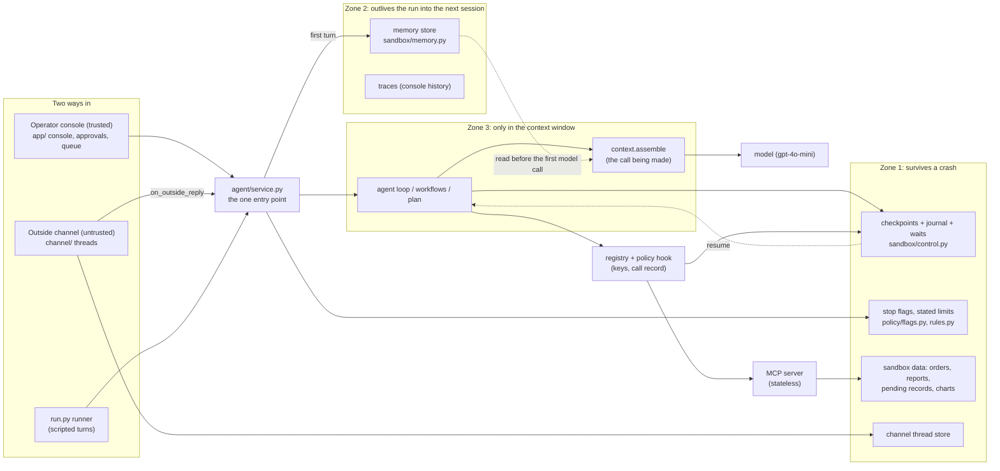

# Milestone 2: Data analyst

**Integration status, 2026-11-22:** The four contributions are integrated. The experimental split is
preserved separately on `m2-split` at `m2-split-final`; the submission's `main` is single-only because a
matched-budget benefit has not been measured. The earlier 589-test integration result and eleven real
process-crash cases remain in [integration evidence](M2-integration-evidence.json) and
[recovery evidence](M2-recovery-evidence.json). Current control/recovery verification is recorded in
[control evidence](M2-controls-evidence.json): 591 tests and all four structure checks pass on single-only
main; the preserved split snapshot passed 611 tests. Earlier branch-only results below remain historical.

Model-written program questions now require approval and resume only their saved inner call. Console
answers to held runs persist before execution and reach the agent before its old pending effects;
fixed workflows accept explicit `retry` or `discard`. The measured build (`m2-build`, 36 runs) and two
improvement passes (72 runs each) ran on 2026-11-22 with gpt-4o-mini and are committed in `results/`; Part 4 and
`experiments/LEDGER.md` give them. No approval session answered by a person was recorded (Part 2, "Who is going to read this?").

The integration fixes cover the real MCP outside/approval contracts, code-owned email disclosure, bounded
operator-history retrieval, crashed-run routing, exact prepared-call replay, and shared three-exit write
settlement, including nested model-written programs. Unknown delivery remains held unless an exact durable receipt verifies its channel message.
The recovery matrix uses real process termination after commit and before acknowledgement/journaling on all
eleven write cases, then checks each complete task script and the absence of duplicate effects.

## Build table

Owners: **claudea** checkpoints/resume/memory/disclosure; **abraham** outside exchange/context/stop/mid-task/split;
**myron** MCP/deferred loading/code calls/policy/approvals/escalation. One row per piece this milestone builds; the
evidence must run (a test, a trace or a command).

| Piece | Owner | Where in the code | Evidence |
|---|---|---|---|
| Checkpoints and the resume | claudea | `agent/checkpoints.py` (placement, modes, journal), `agent/runs.py` (resume, crashed), `sandbox/control.py`, `agent/workflows.py` | `tests/test_recovery.py` (kill -9 during the last write on every task that writes), `tests/test_checkpoints.py`, `tests/test_m2_contracts.py` |
| The three exits, irreversible steps last | claudea | `agent/exits.py`, `agent/compensations.py`, `agent/workflows.py` (`_three_exits`, `_compensate_completed`), `sandbox/reports.py` `withdraw`, `sandbox/charts.py` `delete` | `tests/test_checkpoints.py` (ThreeExitsTest, CompensationsTest) |
| The MCP server | myron | `mcp_server/`, `agent/registry.py`, `agent/tools.py` | `tests/test_mcp.py`; `scripts/strict_request.py` |
| Deferred loading and code calls | myron | `agent/registry.py` (loading), `agent/tools.py` (`search_tools`), `agent/code_calls.py` | `tests/test_deferred.py`, `tests/test_code_calls.py` |
| The outside exchange and its wait | abraham | `agent/outside.py`, `agent/service.py` | `tests/test_outside.py` (real MCP and approval-gated model questions) |
| Context assembly | abraham | `agent/context.py` | `tests/test_context.py` |
| Notes and compaction | abraham | `agent/notes.py`, `agent/context.py` | `tests/test_context.py`, `tasks/sessions/long_campaign.yaml` |
| The memory store and the later session | claudea | `agent/memory.py` (write policy, read), `sandbox/memory.py`, `sandbox/seed.py` (`memory:`), `tasks/memory_subject_preference.yaml`, `checks/memory_preference.py` | `tests/test_memory.py` (three sessions, each its own process); `make serve` later session in the app |
| The policy and the hook | myron | `policy/autonomy.yaml`, `policy/hook.py`, `policy/limits.py`, `policy/rules.py` | `tests/test_hook.py` |
| The approval gate and the queue page | myron | `agent/approvals.py`, `sandbox/queue.py`, `app/templates/approvals.html`, `queue.html` | `tests/test_approval.py` (incl. `tasks/approval_send_*.yaml` end to end), `tests/test_queue.py` |
| The escalation | myron | `agent/escalation.py`, `policy/autonomy.yaml` (`escalate`, `budget`) | `tests/test_escalation.py`; `tasks/escalation_conflicting_figure.yaml` |
| The stop and its three commands | abraham | `agent/stop.py`, `policy/flags.py` | `tests/test_stop.py`; real undo effects in `tests/test_checkpoints.py` |
| Messages mid-task | abraham | `agent/messages.py` | `tests/test_midtask.py`, `tests/test_midtask_plan.py` |
| The disclosure | claudea | `agent/disclosure.py`, `policy/hook.py`, `checks/helpers.py` | `tests/test_disclosure.py`, `tests/test_m2_contracts.py` (DisclosureInChecksTest, the registry refusal) |
| The split experiment | abraham | `agent/split.py` on `m2-split`, preserved at `m2-split-final`; `main` is single-only | Tag's `tests/test_split.py`; free real-MCP task matrix and approval paths |

## Decision table

Milestone 1's rows and columns carry on (see `docs/milestones/M1.md`); this milestone adds the columns below and
the rows each owner fills. Show one of each way where the handout asks: a place where it helps, which you build,
and one where it does not, each argued by the lecture's test.

| Row | Checkpoint (claudea) | Durability mode (claudea) | Code calls (myron) | Loading (myron) | Ask the stranger (abraham) | Notes / compaction (abraham) | Memory (claudea) | Autonomy column (myron) | Approval mode (myron) | Escalation signal (myron) | Topology (abraham) |
|---|---|---|---|---|---|---|---|---|---|---|---|
| standard_report (workflow) | no before 3 render_chart / 4 save_report (keyed, args fixed by code); **yes** before 6 draft_report_email (args from model calls too costly to repeat) (L4 s.11, 13) | async: only keyed, reversible writes (L4 s.12) | no: code fixes every step; nothing loops over many results (L3 s.26-27) | n/a: a workflow sends no definitions | | | | reads and writes independent; the send requires approval | per_action (no plan) | `failed_check` if the draft still fails at its bound | |
| out_of_scope (workflow) | no: one keyed write from a fixed template | async | no | n/a | | | | `draft_clarifying_question/own_thread` independent | none: nothing gated | none: no irreversible step | |
| status_question (workflow) | no: reads only | exit: only answers the operator | no | n/a | | | | reads only, independent | none | none | |
| messy_file, compare_check (agent) | **yes**, every model round: the model writes the arguments, a replay could write others (L4 s.13) | sync: may reach the irreversible send | no: each step depends on what the model just read (our case where code calls do not help) | `all`: 8 definitions, 715 tokens a call; m2-build 5.76 `agent_step` calls per agent run ≈ 4,120 a run | | | | reads/writes independent; send and model-written question require approval; other distributor and margins prohibited | per_action | `failed_check` | |
| batch_reports (plan) | validated graph, outputs and exact resolved arguments saved before each step; completed calls journaled | sync | built, **off** (`code_calls.batch_reports`): one distributor per request in a few calls; m2-build made 0 code calls | `all` | | | | as above, per step | **per_action** (`approval.batch_reports`): a send's `pending_id` and text exist only after its draft passes (L5 s.18); at-plan built, unused | `failed_check` per drafted email | Single; split retained only as an experiment |
| save_report / render_chart / draft_report_email / draft_clarifying_question (writes) | keyed; compensation: withdraw report / delete chart / discard pending (L3 s.41) | | — | always loaded under `deferred` | | | | independent: internal, compensated | none | `unsettled_write` (claudea's third exit) | |
| send_report_email (write) | keyed; irreversible, last on every path; no compensation (L3 s.41) | sync | — | in the `all` list; found by `search_tools` under `deferred` | | | | `own_contact` requires approval; `new_recipient`, `unknown_draft` prohibited | per_action: every send asks | `unsettled_write` | |
| fact: operator's stated preference (semantic) | | | — | — | | | **kept**: stated, not derivable, else re-asked (L4 s.23); `memory.preferences` on | — | — | — | |
| fact: operator's standing rule (procedural) | | | — | — | | | **kept**: stated (L4 s.23); `memory.standing_rules` on | — | — | — | |
| fact: anything the sandbox holds (revenue, reports, status) | | | — | — | | | **not kept**: read fresh from the sandbox; a copy goes stale (L4 s.23, 25) | — | — | — | |
| fact: a stranger's text | | | — | — | | | **not kept**: never stored; would be memory poisoning (L4 s.24) | — | — | — | |
| Ambiguous units upload | **yes**, every model round, as messy_file; the outside wait (thread, keyed question, pending calls) is saved in the checkpoint (L4 s.13, 38) | sync: the run waits for the stranger and may reach the send | no | `all` | Yes: missing units header, fixed template | Current bounded task; notes off | **not kept**: the units answer is the stranger's text, stored on the thread only as ingested and unconfirmed (row "fact: a stranger's text") | `ask_stranger/template` independent (fixed text, one known contact) | none for the template; a model-written question asks | `failed_check` on the later draft | Single: interpretation and report depend on each other |
| Standard report / status | as standard_report and status_question above: **yes** before the draft (report); no, reads only (status) | async (report); exit (status) | no | n/a (workflow) | No: sandbox holds needed facts | Notes off for one short task | preferences read (the subject prefix); revenue and status read fresh, never kept (row "fact: anything the sandbox holds") | independent; the send requires approval | per_action | `failed_check` (report); none (status) | Single: fixed workflow |
| Long console session | **yes**, every model round, one run key per request (`<session_id>#<run_no>`, `agent/runs.py`) | sync: a request may reach the send | no | `all`: definitions ≈4.5% of the 16,000 budget, so deferred is not needed | Per request, never by model doubt | Notes on; compact above 12,000; cap 16,000 input tokens | preferences and standing rules kept across sessions; notes hold the session's IDs and status, and are not memory | each call classed against its own request; stated limits kept as hook rules across compaction | per_action | `failed_check` per run. m2-build: a hold on the first request also refused every later request's calls in the same run (`m2-build-long_campaign-s02-332171.trace.jsonl:41`, then denials from `:55`) | Single: notes and history bound context |
| Topology candidates | n/a on `main` (single); the split's checkpoints are on `m2-split` | n/a on `main` | n/a | split roles: 2 and 3 definitions | Per task | Per session | n/a on `main` (single) | one policy for every role | per_action | the same signals | Per-component gates and pair inventory in `decisions/0006-topology.md` |
| Pass 2: `draft_report_email` description, `tools.send_after_draft` = **off** (inconclusive) | — | — | — | the description is the only change | — | — | — | the send still asks | per_action | — | — |
| Pass 3: `save_report` figures computed by code, `tools.computed_figures` = **on** | unchanged: the key covers kind and period | — | — | definitions unchanged | — | — | — | independent, as other writes | — | fewer `failed_check` holds (held-on-figure runs 11 → 0) | — |

## Part 1: State, the outside exchange and memory

### The durability boundary (claudea)

What carries within a run, between runs, and across a crash (slides 6, 7); what must outlive the run lives in a
store or a checkpoint, never only in the window (slide 30).

| What the system knows | Within a run | Between runs (the operator's next session) | Across a crash or a restart |
|---|---|---|---|
| The operator's current request | the context window, whole in every call | not needed: a new request starts a new run | the run's checkpoint (`operator_text`) |
| The plan and each step's status | the run's state | not needed | the checkpoint and the journal (`sandbox/control.py`) |
| Completed writes and their results | the run's state | the sandbox (reports, pending records) | the journal, and the key on every write |
| A stranger's reply | the context, labelled as the stranger's | the channel's thread store | the thread store, and the wait in the checkpoint |
| A limit the operator stated | a rule (`policy/rules.py`) | the rule, for the session | the rule, in `sandbox/control.py` |
| What the operator said last week (a preference, a standing rule) | read at the session's start | the memory store (`sandbox/memory.py`) | the memory store |
| The model's reasoning so far | the context window only | lost, by design | lost; a resume replays from the checkpoint |



Zone 1 is reset by `make app` and every run.py run and kept by `make serve`; zone 3 is rebuilt from zone 1 on a resume.

### Checkpoints, and writes whose outcome is unknown (claudea)

Every write is keyed by the registry. A checkpoint goes where replaying would repeat an effect no key closes, or
redo work too costly to repeat (slides 11, 13; `checkpoints.needs_checkpoint`):

| Path | Step | Mark | Checkpoint before it? | Why (slides 11, 13) |
|---|---|---|---|---|
| standard_report (workflow) | 1 parse_file, 2 query_sales | read | no | safe to repeat; the journal keeps the result anyway |
| | 3 render_chart, 4 save_report | keyed write, args fixed by code | **no** | the key is the step id: a replay gets the first result back |
| | 5 draft + critique (model calls) | no effect | n/a | |
| | 6 draft_report_email | keyed write, args from model calls | **yes** | after a read too costly to repeat: a resume reuses the passed draft, no model calls |
| out_of_scope (workflow) | 1 draft_clarifying_question (fixed template) | keyed write, args fixed by code | no | key from the step id |
| status_question (workflow) | records | read | no | |
| agent loop (messy_file, compare_check) | every model round | — | **yes** | the model writes the next call's arguments; on a replay it may write others, a new key, a second effect. So the conversation is saved before each round and a resume replays from it |
| | parse_file, query_sales | read | (round's) | |
| | render_chart, save_report, draft_report_email | keyed write, args from the model | (round's) | key from `key_fields`; the saved round fixes the arguments |
| batch_reports (plan) | each plan step | keyed by plan step id | **yes** | `plan_state` saves validated steps, outputs, approval/version state and the exact pending call before execution; resume skips completed outputs |
| waits (outside reply, approval, escalation, stop) | the pause | — | yes | `checkpoints.set_wait`: the run waits on disk, not in a process |

**One of each:** the agent loop's email draft **needs** one (the model writes its recipient and report ID; a replay
could write others: a new key, a second effect); the workflow's `save_report` **does not** (code fixed its arguments,
its key is its step id).

| Kind of run | Durability mode (slide 12) | Why |
|---|---|---|
| agent path (messy_file, compare_check, batch_reports) | sync | can reach the irreversible `send_report_email` |
| standard_report, out_of_scope | async | only keyed, reversible writes: a crash loses at most the step in flight, its key closes it |
| status_question (answers the operator) | exit | reads only: a crash loses the answer, asked again next turn |

| A checkpoint holds (slide 14) | |
|---|---|
| always | path, request, use case, current step, completed calls with keys and results (the journal), what it waits for |
| workflow step 6 | the email arguments that passed the critique |
| agent path | the conversation, whole: one run is one request, bounded by the step limit (a console session's earlier turns are in its trace, not the run's checkpoint) |
| keyed by | the run: run.py's run ID, or `"<session>#<run number>"` in the app, on SQLite; the last checkpoint goes into the trace at the run's end |

| Waiting run | What resumes it (`runs.resume`) |
|---|---|
| a stranger's question | the reply, through `on_outside_reply` |
| a gated call | the operator's answer, `decide_approval` |
| a stop | the operator's `/resume` |
| an escalation | the operator's answer, in any later session |
| a crash | the next ordinary operator turn: `service._resumable_crashes` selects an eligible interrupted run, then `continue_run(..., {kind: crash})` calls `runs.resume`; the new request stays queued; nothing resumes at start-up |

On a resume, a finished step or keyed write comes back from the journal; the step in flight replays with its saved
arguments (coordinators decide, steps act: slide 15).

| A write failed or timed out (L3 slide 40; `agent/exits.py`) | Read the sandbox: did it happen? |
|---|---|
| yes | carry on with the existing result |
| no | retry once under the same key |
| cannot tell | escalate to **the operator** (`unsettled_write`), end the run, write nothing more |

**Irreversible steps last** (slide 41): `send_report_email` comes after the report and its draft on every path; a
write that fails for good after others succeeded compensates them newest first (`agent/compensations.py`).

**The recovery test** (`tests/test_recovery.py`; fake model, one run per task, 2026-11-21) kills the process with
SIGKILL after the sandbox commits each task's last write and before the registry records it, then resumes in a new
process: the check passes, one effect per write, and only the in-flight write ran again. Rows stamped with the
run's ID (reports, pending, charts), joining M1's "Did the effect happen?" table:

| Task | Before the run | After the crash | After the resume | What the resume ran |
|---|---|---|---|---|
| standard_report_clean | 0 reports, 0 pending, 0 charts | 1, 1, 1 | 1, 1, 1 | the email step only, from its saved draft (no model call) |
| out_of_scope_margins | 0, 0, 0 | 0, 1, 0 | 0, 1, 0 | the decline only (the sandbox returned the first record) |
| messy_file_semicolon | 0, 0, 0 | 1, 1, 1 | 1, 1, 1 | the email draft only |
| compare_check_last_quarter | 0, 0, 0 | 1, 1, 1 | 1, 1, 1 | the email draft only |
| memory_subject_preference | 0, 0, 0 | 1, 1, 1 | 1, 1, 1 | the email step only |
| batch_reports_two | 0, 0, 0 | 2, 2, 2 | 2, 2, 2 | second request's prepared email draft; then finish the task script |
| outside_units | 0, 0, 0 | 1, 1, 1 | 1, 1, 1 | saved report after the clarification; one question and one outside answer remain |
| approval_send_report | 0, 0, 0 | 1, 1, 0 | 1, 1, 0 | reconcile the approved send's durable receipt; one sent draft/message |
| approval_send_declined | 0, 0, 0 | 1, 1, 0 | 1, 1, 0 | prepared draft, then the scripted denial; no send |
| escalation_conflicting_figure | 0, 0, 0 | 1, 1, 1 | 1, 1, 1 | prepared draft; finish with database figures, no asserted figure sent |
| long_campaign | 0, 0, 0 | 4, 4, 0 | 4, 4, 0 | fourth draft and remaining status turn; 4/4 facts and 1/1 answer checked |

The six added rows use the 2026-11-22 [recovery evidence](M2-recovery-evidence.json): eleven free-model
cases total, real MCP child and driver killed after commit but before acknowledgement/journaling. Every
complete task script passes, with no repeated completed calls or duplicate effects. Counts above are
reports/pending/charts; the evidence also records channel messages, outside answers and sent drafts.

**Assignment 4** (claudea's, `docs/assignment_refs.md`, `gemini-3.5-flash-lite`, read 2026-11-20): killed at each of
10 steps, derived keys left **0/10** duplicates; random keys **2/10**, both at the last write. So every key here comes
from the effect's identity, and the test kills during the last write.

### The MCP server (myron)

*Owner: myron.* The tools are served by our own MCP server (`mcp_server/`), built on the official Python SDK
`mcp` **2.3.0**, which implements protocol revision **2026-07-28**, the stateless one (checked 2026-11-20 on
PyPI and in the SDK's `LATEST_PROTOCOL_VERSION`). Every request carries its own envelope in `params._meta`;
there is no `initialize` and no session. The SDK still accepts the old handshake from old clients, but our
client never sends it, and we use none of Roots, Sampling or Logging. The registry's process starts the
server as a child (`mcp_server/client.py`) on the first tool call, so `make app` and `run.py` need nothing
more. A dead server is started again on the next call, which works because nothing a call needs lives in
the server.

The registry stays in our code in front of every call: it validates, derives the write key, asks the hook,
and records the call, and only then sends `tools/call`. The model never sees the key. Each call's `_meta`
carries the IDs it needs: the request, the run or console session that stamps its writes, the state folder,
and the key. Results return the next IDs (`report_id`, `pending_id`, `thread_id`). The sandbox accepts each
key once (UNIQUE key columns), and `tools/list` returns the catalogue in the registry's fixed order.

Errors come back in two classes. An execution error returns `isError: true` with a failure class (transient,
ambiguous, permanent), which the registry routes as in Milestone 1. A protocol error (unknown tool, missing
context) is a JSON-RPC error, which the registry turns into `protocol_error`. A lost stream on a write is an
unknown outcome (`ambiguous_write`), never a blind retry. `run_program` is the one tool that runs in the
registry's process; every call its program makes still goes through the registry to the server.

**Strict mode as sent.** `scripts/strict_request.py` sends one request with the five strict definitions
(`query_sales`, `ask_stranger`, `send_report_email`, `search_tools`, `run_program`) exactly as the registry
sends them, and keeps OpenAI's answer in `experiments/evidence/strict_request.json`.
**OpenAI accepted all five** (2026-11-21 03:13 UTC; served by gpt-4o-mini-2024-07-18; one request). An
earlier attempt from a shell with a different key environment got HTTP 400 with no message kept. It was not
reproduced: the request was the same, and the retry through `scripts/with_env.py` was accepted.
`parse_file` stays non-strict because its two arguments are optional.

### A tool list that does not crowd the window (myron)

*Owner: myron.* **The bill** (Lecture 3, slide 23). Milestone 1 measured the six rewritten definitions at
**551 input tokens per call** (`experiments/evidence/definition_cost_final.json`, gpt-4o-mini-2024-07-18,
2026-10-31, one with/without pair). Only agent-path calls carry definitions: the M1 baseline made
**4.67 `agent_step` calls per agent run** (28 calls over 6 runs: compare_check 4.33, messy_file 5.00;
`results/baseline/`, 18 runs). That is about **2,570 definition tokens per agent run** in Milestone 1.

Milestone 2's list is 8 definitions with `tools.loading=all`, measured at **715 input tokens per call**
(`experiments/evidence/definition_cost_m2.json`, gpt-4o-mini-2024-07-18, 2026-11-21, one with/without pair
per surface). At M1's call rate that is about **3,340 per agent run**, 0.56% of gpt-4o-mini's 128k window
and 4.5% of our 16,000-token `context_budget`. With `run_program` it is 9 definitions at **809**; a deferred
first request carries 5 at **475**, so deferred saves at most 240 tokens a call. There is one agent;
the preserved split has two definitions for its analyst (`parse_file`, `query_sales`) and three for its
writer (`render_chart`, `save_report`, `draft_report_email`). Their serialized-definition estimates are
310 and 473 tokens per role call, respectively (ceiling of characters/4; one calculation per surface,
2026-11-22, `docs/abraham-m2-test-evidence.json`), not provider-metered token costs. In `m2-build` the agent path made **5.76 `agent_step` calls per agent run** (121 calls over 21 agent-path runs, `results/m2-build/`, 36 runs, read 2026-11-22), so about **4,120 definition tokens per agent run**, still ≈4.5% of the budget per call.

**The fixes, in slide 28's order.**
1. *A fixed order*: built in M1, and `tools/list` keeps it.
2. *Remove or merge*: the send is one tool, narrowed to a draft for the request's own contact. The draft
   tool refuses any other recipient.
3. *Deferred loading*: built behind `tools.loading` (`search_tools` in the MCP server, the always-loaded
   tools, found definitions joining the next request, misses logged), but set to **all**. Eight
   definitions is below slide 24's ~10, and at ≈4.5% of the budget the definitions are not what crowds a
   call.
4. *Code calls*: per use case. `batch_reports` comes closest to a loop over many results (several
   distributors), so the program runs there behind `code_calls.batch_reports`, set **off**. Each
   request's registry reads one distributor in a handful of calls, and the plan already fixes the order.
   A case where code calls clearly help would be one request filtering hundreds of order rows to a few
   totals; `messy_file` is the case where they do not, since every step depends on what the model just
   read in the file.

The program runs as `python -I` in a scratch folder. An audit hook refuses sockets, subprocesses and files
outside that folder, and only its `result` returns.

### The outside exchange, and a wait that survives a restart (abraham)

A messy upload asks only when a successful parse has no recognized units header. Known formats, status questions and standard reports do not ask: the sandbox holds their facts. Code supplies the fixed `units_column` question and disclosure with `caller="code"`; model-written questions require approval.

The keyed question and exact pending calls are saved with the run. The wait lasts 48 hours. A reply claims the wait once, persists as `outside_reply_from_stranger`, and resumes through the common run entry; it cannot grant permission. A stopped run keeps the first reply until `/resume`. Duplicate or conflicting later replies cannot replace it. `human`, an invalid column, or an expired deadline holds for operator review. Deadlines are checked lazily on a subsequent console/thread event, not by a background worker. The threads page shows waiting, answered or held from persisted state.

`tests/test_outside.py` asks in one process and replies in another through `harness.turns.outside_reply`, using the real registry, policy, MCP and sandbox. The check requires one disclosed question before the reply and a saved report with 800 file units. Tests also cover exact replay, partial tool batches, stopped duplicates, stale approvals and queue draining. `outside_units` is in the eleven-case crash matrix; its task requests a saved report, so it establishes no clarified-email quality result.

### Context, within a budget (abraham)

Every model call, including routing and planning, uses `agent/context.py`: 16,000 estimated input tokens, including system text, tools and messages (ceiling of characters/4). Above 12,000, compaction removes old result arrays/long text, extracts older prose, then omits oldest complete exchanges. Scalar results and IDs survive; tool calls/results stay paired. The current request and newest exchange remain whole or the call is refused. Traces record estimates and omitted sources; these are not vendor token counts.

Notes and exact source-labelled events live in the control database; reset clears them, `make serve` keeps them. Notes hold IDs/status, never stranger prose. `/history <query>` retrieves original events. Executors retrieve bounded operator history, prioritizing the first instruction and recent corrections; planners exclude session prose and stranger memory. Verified operator/system memory carries provenance. Compaction changes only the sent copy.

`notes.console` is on for multi-request sessions; bounded single tasks leave it off. Large inputs use bounded tool results and IDs; oversized mandatory requests are refused. Each call durably reserves estimated input plus the output cap, then settles actual usage; a crash keeps the reservation charged. At the session ceiling, the operator starts a new session that reads memory; previous notes/events remain available through the old session's history.

`tests/test_context.py` checks tool-inclusive budgets, refusal, atomic exchanges, provenance, unchanged notes, persistence/reset and durable reservations. `tasks/sessions/long_campaign.yaml` supplies four reporting tasks, over three budgets of history, an early campaign code needed later, and a final answer checked against saved revenue. These free tests establish mechanics. The paid build's three long-session runs fail after the first report is held; Part 4 separates that cascade from compaction and reports the measured cost and fact-use counts.

Claudea's A2 Part G (`docs/assignment_refs.md`, read 2026-11-20, `gemini-3.5-flash-lite`) found 32/36 answers without notes versus 36/36 with notes across 12 runs; mean tokens were 9,489 versus 10,286 (six runs/arm). Its forced 500-token threshold and different model limit transfer: the largest ordinary prompt was 4,787 tokens. This supports testing our long-session mechanism, not claiming a measured benefit.

Historical synthetic evidence, read 2026-11-20: one long-session run read 51,486 estimated history tokens, made 21 model calls, used 311,061 fake tokens, reached 15,850 estimated input tokens per call, and compacted 20 times. The sandbox confirmed 4/4 campaign facts and 1/1 final answer (`docs/abraham-m2-test-evidence.json`). Current `tests.test_context` checks the mechanism; rerunning it need not reproduce those historical totals.

### Memory with provenance, and the operator's later session (claudea)

| Kind of fact (slides 18, 23) | Kept? | Why |
|---|---|---|
| the operator's stated preference (semantic; such as a subject prefix on every report email) | **kept** (`memory.preferences`) | stated, not derivable from any record; else asked again every session |
| the operator's standing rule (procedural; "from now on, always ...") | **kept** (`memory.standing_rules`) | stated by the trusted operator |
| anything the sandbox holds (revenue, last quarter's report, a request's status) | **not kept** | read fresh from the sandbox; a copy could only go stale |
| a stranger's text | **not kept** | it would come back as our own knowledge: memory poisoning (slide 24) |

| Write policy (slide 23; `memory.write`, the one place) | |
|---|---|
| how | insert a new name; merge a repeat; a new value supersedes the old, both kept, with timestamps and which replaced which |
| with | provenance on every record: source, written_at, derived_or_ingested, confirmed |
| when | at a run's end (`runs.end`), from the operator's own lines, by code; never mid-run on a guess |

| Failure it invites (slide 25) | Answer |
|---|---|
| stale | every record shows its age; unread for 180 days, it expires when next read |
| contradictory | supersede, never append a rival |
| unbounded | 200 records at most; superseded first, then least recently read |

**Lifetime:** one of 8 test tasks states a fact; at about 2 stated facts a day (assumed: m2-build stated none, 0 memory writes in 36 runs, because the memory task seeds its earlier session's record), 200 records
last about 100 days before eviction starts.

**The later session.** After `make serve` the console lists the earlier sessions with their history. A new session
reads the store and the waiting runs **before its first model call**, logs the read (`memory_read`: each record's
id, age, source) and shows the operator each one ("Remembered (2 days old, from the operator): ..."). The read takes
the kept kinds whose switch is on, newest first, within a token budget; the model sees only what assembly puts in
(slide 20). A record can be lost when **written** (a fact in a turn that ends with no run waits for the next run's
end), **stored** (evicted), **searched for** (expired, over budget) or **used** (not attended to; the subject
prefix is applied by code, so it cannot be). Evidence: `tests/test_memory.py` (three sessions, each its own
process), the app served, stopped and served again, and `tasks/memory_subject_preference.yaml`.

### The orchestration abstraction (claudea)

| Question | Answer here | Piece |
|---|---|---|
| Do you know the steps and their order in advance? | for the workflows and a validated batch plan, yes; for the agent path, no | a graph (workflow code, the plan's dependency order) for those; an event-driven loop, the model choosing the next tool, for the agent path |
| Do runs outlive a single process? | yes: a run waits days for a stranger or an approval, and console sessions survive a restart | checkpoints on disk (`sandbox/control.py`) |
| Do steps have irreversible side effects? | yes: an emailed report cannot be recalled | a key on every write; durable execution only if a half-done run must finish on its own, which ours need not |
| Do you want to write the loop and compaction yourself? | yes | our own harness; the context decisions are ours either way |

Durable execution is a checkpoint, a journal and a supervisor (slide 37): we have the first two, **no supervisor**.
Slide 40: does it notice a run died? **No.** Restart it without a person? **No.** Stop finished work being done
twice? **Yes** (journal, keys). **A recovery aid, not a guarantee;** the operator fills the gap: their next turn
resumes a crashed run.

### "Which boundary lost it?" (claudea; rows from abraham and myron)

Boundaries (slide 34, the context split as in Assignment 4's Part F): attention, compaction, the session, a restart.

| Fact | Boundary that could lose it | What holds it across |
|---|---|---|
| The operator's current request | compaction (a long session) | mandatory current request and newest exchange stay whole; refuse if they cannot fit with system/tools; checkpoint `operator_text` survives restart |
| Each step's status and the completed calls | restart | the checkpoint and the journal; keys on every write |
| The plan as validated | restart | durable `plan_state`: graph/version, outputs, approval, budget and exact pending arguments; completed steps are skipped |
| A stranger's reply | restart | the channel's thread store and the wait in the checkpoint |
| A stranger's reply, later in a long session | compaction | notes keep IDs/status; raw words remain source-labelled in channel/events; planner receives identity/status, never that prose |
| A limit the operator stated ("send nothing until I have read it") | compaction, session | a rule the hook reads (`policy/rules.py`), never only text in the chat |
| A preference or standing rule stated in an earlier session | session | the memory store, read before the first model call |
| The same, read but not attended to | attention | shown to the operator; a preference applied by code (the subject prefix) |
| A gated call waiting for the operator | restart | the approval record in the control file beside the checkpoints (`agent/approvals.py`) and the checkpoint's wait of kind `approval`; `decide_approval` resumes through `runs.resume` (`tests/test_approval.py`, restart test) |
| A run held by an escalation | restart | the checkpoint's `held`, and the queue |

Assignment 4 (`docs/assignment_refs.md`): attention, compaction and session each lost its fact and its fix restored
it, 3/3; the restart held across all 10 kill points. **Gaps:** a fact stated in a turn that ends with no run waits
for the next run's end; no supervisor. Batch crash recovery now restores the saved plan and is checked in the eleven-case matrix.
No pass measured a row of this table: Pass 2 changed one tool description and Pass 3 the report's figures, neither a boundary here (m2-build 36 runs, Pass 2 and Pass 3 72 runs each, read 2026-11-22).

## Part 2: Autonomy, approvals and the stop

### Rank every action (myron)

*Owner: myron.* Every action went through the four steps (Lecture 5, slide 14): remove or narrow, then the
undo path, then the blast radius, then gate only what is irreversible and wide. Removed or narrowed:
- no margins tool exists (`sandbox/margins.py` is never imported by a tool);
- `query_sales` takes no distributor argument;
- `draft_report_email` and `send_report_email` act only on the request's own contact;
- `ask_stranger` writes only on the request's own thread.

The tools' MCP annotations (read-only, destructive) word the server's hints and decide nothing.

| Action / circumstance | Undo path | Would anyone notice? | Blast radius | Column |
|---|---|---|---|---|
| `parse_file/own_request` | nothing changes | n/a | internal, one upload | independent |
| `query_sales/own_distributor` | nothing changes | n/a | internal, one distributor | independent |
| `query_sales/other_distributor` | (a leak cannot be undone) | the distributor, too late | another company's figures | prohibited |
| `read_margins/any` | (cannot be undone) | too late | private cost data | prohibited |
| `render_chart/own_request` | compensated: delete the chart | the operator, on the request page | internal, agent-created | independent |
| `save_report/own_request` | reverted: previous version | the operator; the check | internal, agent-created | independent |
| `draft_report_email/own_contact` | compensated: discard the draft | the operator before any send | internal (pending) | independent |
| `draft_clarifying_question/own_thread` | compensated: discard | the operator | internal (pending) | independent |
| `ask_stranger/template` | none | the distributor | one known contact, fixed text | independent |
| `ask_stranger/model_written` | none | the distributor | one contact, text unknown in advance | requires approval |
| `send_report_email/own_contact` | none: an email cannot be recalled | the distributor | outside the company, figures | requires approval |
| `send_report_email/new_recipient` | none | a stranger | anyone | prohibited |
| `send_report_email/unknown_draft` | none | — | a record not drafted for this request | prohibited |
| `search_tools/any`, `run_program/any` | nothing of their own | n/a | each inner call is hooked again | independent |

### The policy in three columns, and the hook (myron)

*Owner: myron.* `policy/autonomy.yaml` holds the three columns by action class, each with its reason from
the ranking above. The model never sees it. `policy/hook.py` decides in this order:
1. the stop flag;
2. a run held by an escalation;
3. the prohibited column;
4. the operator's stated limits;
5. the disclosure line on any send;
6. the columns.

A class in no column is denied, and a hook that raises denies (`tests/test_hook.py`). Approvals are read
only after the prohibited column, so no answer from the app turns a prohibition into a yes; the test
scripts every approval to yes and the sandbox stays unchanged.

**One that runs alone, one that asks.** `ask_stranger` is split by circumstance:
- `ask_stranger/template` runs alone: our code writes a fixed question to the request's own contact.
  It is irreversible but narrow, and its text is known in advance.
- `ask_stranger/model_written` asks: the same reach, but the text is the model's.

**Prohibited**: a send to anyone but the request's contact, a send of a record that is not this request's
draft, another distributor's sales, and margins.

**Stated limits** become rules in code. `policy/limits.py` parses "send nothing until I have read it" into
an `ask` rule over every send (`sends/*`), and "do not send any emails" into a `deny` rule. The service
calls it before any model sees the text.

### The approval gate and the queue page (myron)

*Owner: myron.* A gated call puts up an approval (`agent/approvals.py`, stored in the control file beside
the checkpoints) and ends its turn. Nothing in that run proceeds. `decide_approval` resumes the run through
`runs.resume`, in a new process too (`tests/test_approval.py`, the restart test).

Each item carries its console session's `session_id`. Its screen (Appendix) is the dry run, then facts
computed from the sandbox, then the stranger's words labelled as theirs. It shows no model rationale.

Every decision is logged as an `approval_decision` line: action class, the facts shown, the decision, who
decided, seconds, the switch setting and the run key. The queue page (`sandbox/queue.py`) lists:
- requests and their status;
- held runs, marked when over the cap;
- runs waiting on a stranger, an approval or a stop;
- approvals waiting.

**At the plan or per action** (Lecture 5, slide 18). `batch_reports` is the one use case with a plan, and
it is set to **per_action**. Its gated step, the send, has a `pending_id` and text that exist only after
each draft passes the critique, so a plan approved in advance could not fix what it sends. At-plan
approval is built (`put_up_plan`, `plan_covers`; a revision or an unlisted call asks again) for the case
where it would help: a plan whose sends are fixed when it is validated, such as a batch of fixed-template
questions. A5's batched review cut prompts from **14 to 11 a day** but raised seconds per prompt from
**42.9 to 54.5**, and its authors call 11 a floor (claudea24/agentic-ai-assignment5 @ 4110654,
`gemini-3.5-flash-lite`, one recorded day; `docs/assignment_refs.md`). At our send volume the saving is
smaller than the risk of approving text not yet written.

**What still checks each step's output**: the external critique on every draft, the hook's disclosure
check, and the screen's recomputed figures. **When a plan review would be asked**: only on a run whose
plan lists a send, so a batch the operator did not ask to send never asks.

### The escalation (myron)

*Owner: myron.* Signals are named in advance in `policy/autonomy.yaml`, never on low confidence
(`escalation.signal` refuses any other name):
- **`failed_check`**: the critique still fails a report email at its bound (`agent/critique.py`). It covers
  every use case that drafts an email (`messy_file`, `compare_check`, `batch_reports`, `standard_report`).
- **`unsettled_write`**: claudea's third exit, for a write whose outcome cannot be told.
  Wired: `agent/exits.py` (line 111) calls `escalation.signal(run_key, "unsettled_write", ...)` and the run ends
  `unsettled_write` (`tests/test_checkpoints.py`, ThreeExitsTest, checks the end and the packet). m2-build and both passes: 0 such escalations.

`status_question` and `out_of_scope` have no irreversible step and no such signal, so no escalation covers
them. "The same step blocked three times" was considered and not built: the step bound already ends such
a run, and doubt about a reversible, visible action proceeds (Lecture 5, slide 38).

**The packet**: what the run attempted, why it stopped, what it needs; three non-empty fields, returned as
the held turn's console text (`packet_text`). **The hold**: the run's checkpoint takes `held` plus a wait
of kind `escalation`, and the hook refuses its every call. The answer in a later session resumes it
(`escalation.answer` → `runs.resume`; `tests/test_escalation.py` resumes with no duplicate). With no answer
within 24 hours the run ends held, never approved. **The budget**: 20 asks a day, approvals and packets
counted together. Past it a signal still holds but sends no packet, and the queue marks the run over the
cap. `tasks/escalation_conflicting_figure.yaml` exercises it with a figure the stranger asserts.

### The stop (abraham)

Owner: abraham. `agent/stop.py`, `policy/flags.py`; evidence: `python -m unittest tests.test_stop -v`.

The console recognizes `/stop`, `/stop <n>`, `/cancel <n>`, `/resume <n>` and `/rollback <n>` before a model call. A session stop snapshots the existing runs, so a later run—even in the same clock tick—is not accidentally stopped. The registry hook reads the durable flag, and the loop, context assembler and plan also check before calls. Each first write and resume emits a visible notice. Stop/clear events and their times survive restart in the resettable control store.

| Condition | Behavior and evidence |
|---|---|
| Watched | A run-numbered notice is traced before the first write and again on resume; `tests.test_midtask.ThreadedServiceControlTest` exercises a second thread while a real turn runs. |
| Fast | The next registry call is refused; `test_five_stops_refuse_the_next_registry_write` times five stops and confirms zero writes after them. One local run read 2026-11-20 recorded 0.00560, 0.00566, 0.00508, 0.00555 and 0.00531 seconds (5 samples; source `docs/abraham-m2-test-evidence.json`; not a measured improvement arm). The in-flight call is allowed to return and is journaled before the stopped checkpoint is emitted. |
| Durable | Checkpoints retain completed calls and exact saved arguments. Stop flags, withdrawn approval packets and outside replies persist across a process restart. Resume re-asks withdrawn approvals with the same arguments and updates the saved plan's approval ID. A reply received during a stop remains labelled stranger data and is used only after resume. |
| Safe (partial) | A running irreversible send cannot be unsent. Rollback applies the available compensations in reverse order, prints `none` for irreversible effects, and records every result. An uncertain compensation is held for inspection instead of blindly retried. The public service refuses rollback/resume while a call is still executing; the operator retries after it returns. |
| Outside the agent | Only operator commands clear the flag. The hook refuses later calls regardless of model instructions; a late stranger reply cannot revive a cancelled run. |

Cancel ends the run permanently and keeps earlier effects. Resume lifts the flag with a timestamp, then continues saved state or waits for a reissued approval/an existing outside answer. Rollback leaves the run stopped and reverses only supported writes. Once an actual compensation has changed the sandbox, a fresh task is required: the old journal describes effects that have been undone.

`Registry.compensate` now uses the real undo table: discard pending records, withdraw/restore reports and delete charts; irreversible sends have none. It is a registry-internal code path, unavailable to the model, rather than a normal policy-hook tool call. `tests.test_checkpoints.CompensationsTest` checks persisted undo effects and reverse order; `tests.test_stop` checks operator rollback ordering, deduplication and the requirement for a fresh task afterward.

### Messages mid-task (abraham)

`/add [n]` adds an instruction; `/replace [n]` cancels, lists existing effects and queues the replacement. The operator chooses; no model classifies intent. Plain text queues up to eight messages. Ambiguous runs, invalid commands and messages over 16,000 characters are refused; stated limits become hook rules.

Mailbox consumption and checkpoint additions are atomic, before the next model call. Replacement waits for any in-flight call to return and be recorded; queued work starts only at a safe boundary. Control state survives restart and clears on reset. Threaded tests exercise both commands (`tests/test_midtask.py`).

Validated plans are reviewed before gated effects; revisions ask again. Unresolved bindings cannot preapprove future arguments. Saved graphs, outputs and pending calls resume without repeating completed reads (`tests/test_midtask_plan.py`).

### Tell the stranger an agent wrote it (claudea)

| Question (slides 42 to 44, 47) | Answer for this system |
|---|---|
| EU AI Act: what is it used for? | reporting a distributor's own sales back to it: not a banned practice, not an Annex III high-risk use (it decides nothing about a person); a real deployment's status is counsel's call |
| EU AI Act: does it talk with people or make content? | yes: it writes to distributors' contacts, so Article 50 applies from 2 August 2026; being an AI is not obvious in an email thread |
| Colorado's, California's human-review rules | reach consequential decisions about people (hiring, lending, housing); ours makes none, so neither reaches it as built |

The line is added in code (`agent/disclosure.py`), never by a prompt: *"This message was written by an automated
agent for the sales analytics team. To reach a person, reply to this thread with "human" and an analyst will
answer."* Every send passes `with_disclosure` before the registry, so the approval dry run shows it; the hook
refuses a send without it and logs the refusal (`hook_decision` deny; `tool_call` outcome `denied`); every task's
check fails an agent message without it. The operator's own hand-sent mail carries none. Evidence:
`tests/test_disclosure.py`, `tests/test_m2_contracts.py`.

### "Who is going to read this, and will they?" (myron)

*Owner: myron.*

| Point | Who reads it | Times a day | Seconds they have | What they see |
|---|---|---|---|---|
| `send_report_email/own_contact` | the analyst at the console | m2-build: **0 per run** (0 of 36 runs reached the gate) × 20 = 0 measured; Pass 2's arms: **3 of 72 runs** reached it (off 2/36, on 1/36), 0.04 per run × 20 ≈ **0.8 a day** | not measured: no session answered by a person was recorded | dry run + computed checks; the stranger's text asserted |
| `ask_stranger/model_written` | the analyst | m2-build: **0 per run** (0 asked; 3 questions were `template`, which run unasked) | not measured (no person-answered session) | the question as sent, reach, private-record scan |
| escalation packet | the analyst | m2-build: **13 packets in 36 runs, 0.36 per run** × 20 ≈ **7.2 a day**, capped at 20 with approvals (0 over the cap); at least 2 held on a critique false positive (`m2-build-approval_send_report-s01-cc4bb6.trace.jsonl:41`, `:45`) | not measured (no person-answered session) | attempted / why / needs (computed) |
| stop notice | the analyst | One before a writing run's first effect, plus one per explicit resume. m2-build: **32 notices in 36 runs, 0.89 per run** × 20 ≈ **17.8 a day** (none in the three read-only `status_question_done_work` runs or in `batch_reports_two-s03`, which ended at `replan_bound` before its first write; no resumes); Pass 2's arms 33/36 each (`results/m2-build/`, `results/pass2-send-after-draft-{off,on}/`, read 2026-11-22; first at `m2-build-approval_send_declined-s01-1fec93.trace.jsonl:32`). It asks nothing, so it is not counted in asks a day | — | the run named before its first write |
| the stranger | the distributor's contact | one per send | as long as they like | the email, with the line saying an agent wrote it |

**A real day** (assumed, not measured): about 20 requests, one analyst answering at the console for
10 minutes a day. Seconds per ask = 600 ÷ asks a day: from `m2-build`, 0 approvals + 0.36 packets per run × 20 runs ≈ 7.2 asks a day, so about **83 s per ask** (`results/m2-build/`, 36 runs, read 2026-11-22). Pass 2 did not raise the approvals' share: the send reached its gate in 3 of 72 runs (0.04 per run, ≈ 0.8 a day), which would make about 8 asks and 75 s per ask, and `tools.send_after_draft` stayed off, so the build's 83 s stands (`results/pass2-send-after-draft-{off,on}/`, 72 runs, read 2026-11-22). With `tools.computed_figures` on (Pass 3's verdict) fewer drafts are held: its on arm had 8 escalation packets and 1 approval in 36 runs, 0.25 asks per run × 20 ≈ **5 a day**, about **120 s per ask** (`results/pass3-computed-figures-on/`, 36 runs, read 2026-11-22), at the slide-62 line of about five. A5 gave
**42.9 s** at 14 prompts a day. Its human decisions approved **0.35 overall (6/17) and 0.00 (0/4) on the
irreversible, wide classes**, median 33.5 s (`open_pr`) and 27.2 s (`post_comment`)
(`docs/assignment_refs.md`, A5). The rate and seconds by class here come only from console sessions a
person answered (T3b; scripted answers take no time). None was recorded, so no approval rate or seconds by class are claimed for this system; A5's figures above are the only human timings cited.

**Shortcuts the screens invite** (slide 24):
- *a quick glance*: the dry run is long, so the computed checks line sits beside it;
- *passing tests as proof*: "This run's checks" is recomputed from the database, not the critique's
  verdict;
- *trusting the agent where they know least*: the stranger's text is marked asserted.

**Placement** (slides 11, 12, 62): if a gated class passes about five asks a day, the action is a rule
(the template question) or a prohibition (new recipients) before at-plan approval.
**Our level.** On the Knight Institute's five levels, named by the user's role, our agent is at **Level 4, the user as approver**: the agent acts alone on reads and internal, reversible writes, and stops for a person only before an irreversible step that leaves the company. On Interface and the Ada Lovelace Institute's five levels (scope, control, tool access) we place it at **Level 3**, by comparison with the lecture's own worked case: slide 12 places RepoMind at "Knight Level 4, CSA Tier 2, Interface Level 3", and our agent has RepoMind's shape on the two frameworks we place directly (it acts alone on reads and reversible internal writes, its scope is one request's own distributor, its tools are bound by code, and a person approves each irreversible outward step). This placement rests on that comparison, not on the level definitions, whose diagram text we could not extract from the lecture PDF. On the CSA tiers this is **Tier 2** (slide 12), and what that tier owes is in the build: scope documentation → `policy/autonomy.yaml` and M1's use cases; a delegation policy → the three columns and the stated limits (`policy/limits.py`); escalation triggers → `escalate` (`failed_check`, `unsettled_write`).

## Part 3: The topology (abraham)

**Decision: single-only on `main`.** The experiment is preserved on `m2-split` at `m2-split-final`.
The pair inventory, arrows and ordered gates are in `decisions/0006-topology.md`. Decoder/writer
corrections fail the little-communication gate. Independent distributor workers pass the first two
gates, but two short chains show no capability or cost advantage over the existing plan executor
(gate 3); the experiment earns no matched-budget benefit claim.

The experimental read-only analyst hands checked facts to an artifact writer. Code validates every
return, attributes calls to roles/parent IDs, checks claimed artifacts against successful calls and
rereads the combined sandbox state. Sequential roles never wait on one another; writers own distinct
requests. One 150,000-token allowance covers all roles and critique; durable reservations and responses
bound crash/retry spending. The four-task long session has its separate 400,000-token ceiling.
`tests/test_split.py` at the tag tests these mechanisms with real MCP and fake models, including the
official task matrix, approvals, corrupt returns/artifacts, stops and resume. Only batch requests split.
These are free correctness checks, not accuracy, latency or equal-spend measurements.

Claudea's A6 (`docs/assignment_refs.md`, read 2026-11-20, `gemini-3.5-flash-lite`, 72 runs)
reported split/single token multipliers of 0.70 for single tasks and 0.51 for batches. Split versus
purported matched-arm passes were 15/18 versus 11/18 and 0/6 versus 1/6; those arms spent 28% and
17% less than split. Original single-agent batches passed 4/6. This cannot establish matched-spend
benefit here; reopening requires the decision file's controlled comparison.

## Part 4: The passes (myron: runs and ledger; abraham: first failures; claudea: recompute)

### The build's runs: the first thing that went wrong (abraham)

Read 2026-11-22 from all 36 non-free, completed `m2-build` records: 12 tasks × three sweeps,
all `dirty=false` at `8cd2be3`, model `gpt-4o-mini`. The independent task checks pass **20/36**
(sweeps **6/12, 8/12, 6/12**). All records have paired traces; the failure reader reports no missing
or malformed evidence. These are pilot results, not a reliability estimate.

[Recomputed metrics](../../experiments/evidence/m2-build-analysis.json) and
[first-failure evidence](../../experiments/evidence/m2-build-first-failures.json) retain the 16 failures,
their independent check results, the first detected signal, raw-file hashes and diagnostic probes.
The table distinguishes the first defective proposal/decision from the later check that exposed it.
Trace links name physical JSONL lines; full model `content` is used because the `text` preview stops
at 2,000 characters. Normal waits, correct refusals and compaction are not failures by themselves.

| Run ID | Task | First thing that went wrong (the lectures' words) | Trace evidence |
|---|---|---|---|
| `m2-build-approval_send_declined-s01-1fec93` | `approval_send_declined` | **Bounded critique / unreliable outside signal.** The email contains an unfilled name slot. The check also reads the year in the saved report as a revenue amount. Revision removes the slot but cannot change that saved report, so the run remains held and never reaches the rejection gate. | [saved prose L43](../../results/m2-build/m2-build-approval_send_declined-s01-1fec93.trace.jsonl#L43); [draft L48](../../results/m2-build/m2-build-approval_send_declined-s01-1fec93.trace.jsonl#L48); [first check L49](../../results/m2-build/m2-build-approval_send_declined-s01-1fec93.trace.jsonl#L49); [held L53](../../results/m2-build/m2-build-approval_send_declined-s01-1fec93.trace.jsonl#L53) |
| `m2-build-approval_send_declined-s02-4044d3` | `approval_send_declined` | **False finish / missing tool call.** The draft passes and is saved, but the model ends by inviting another confirmation instead of calling send_report_email. No actual approval is queued, so the scripted rejection cannot occur. The stopping description is Pass 2's hypothesis, not a cause proved by this trace alone. | [check passes L41](../../results/m2-build/m2-build-approval_send_declined-s02-4044d3.trace.jsonl#L41); [draft saved L44](../../results/m2-build/m2-build-approval_send_declined-s02-4044d3.trace.jsonl#L44); [premature finish L49](../../results/m2-build/m2-build-approval_send_declined-s02-4044d3.trace.jsonl#L49); [task check L53](../../results/m2-build/m2-build-approval_send_declined-s02-4044d3.trace.jsonl#L53) |
| `m2-build-approval_send_declined-s03-9984b1` | `approval_send_declined` | **False finish / missing tool call.** After a passing draft the model asks the operator to confirm, without calling send_report_email or putting up an approval. The requested rejection path is never exercised. | [check passes L41](../../results/m2-build/m2-build-approval_send_declined-s03-9984b1.trace.jsonl#L41); [draft saved L44](../../results/m2-build/m2-build-approval_send_declined-s03-9984b1.trace.jsonl#L44); [premature finish L49](../../results/m2-build/m2-build-approval_send_declined-s03-9984b1.trace.jsonl#L49); [task check L53](../../results/m2-build/m2-build-approval_send_declined-s03-9984b1.trace.jsonl#L53) |
| `m2-build-approval_send_report-s01-cc4bb6` | `approval_send_report` | **Bounded critique / unreliable outside signal.** The first email has a name placeholder. After its repair, the check still treats “sales for the third quarter of 2026” in the saved report as a revenue assertion. Correct numeric figures cannot overcome this prose false positive; no draft or send reaches approval. | [saved prose L35](../../results/m2-build/m2-build-approval_send_report-s01-cc4bb6.trace.jsonl#L35); [draft L40](../../results/m2-build/m2-build-approval_send_report-s01-cc4bb6.trace.jsonl#L40); [first check L41](../../results/m2-build/m2-build-approval_send_report-s01-cc4bb6.trace.jsonl#L41); [held L45](../../results/m2-build/m2-build-approval_send_report-s01-cc4bb6.trace.jsonl#L45) |
| `m2-build-approval_send_report-s02-cd1fbd` | `approval_send_report` | **False finish / missing tool call.** The model saves a passing email draft and says the request is complete, but leaves sending for another confirmation. It never calls the gated send despite the original send instruction. | [check passes L41](../../results/m2-build/m2-build-approval_send_report-s02-cd1fbd.trace.jsonl#L41); [draft saved L44](../../results/m2-build/m2-build-approval_send_report-s02-cd1fbd.trace.jsonl#L44); [premature finish L49](../../results/m2-build/m2-build-approval_send_report-s02-cd1fbd.trace.jsonl#L49); [task check L53](../../results/m2-build/m2-build-approval_send_report-s02-cd1fbd.trace.jsonl#L53) |
| `m2-build-approval_send_report-s03-9119b1` | `approval_send_report` | **False finish / missing tool call.** The model ends after creating the pending email and offers to send later. A pending draft is not a queued approval or a sent message; the requested effect is absent. | [check passes L41](../../results/m2-build/m2-build-approval_send_report-s03-9119b1.trace.jsonl#L41); [draft saved L44](../../results/m2-build/m2-build-approval_send_report-s03-9119b1.trace.jsonl#L44); [premature finish L49](../../results/m2-build/m2-build-approval_send_report-s03-9119b1.trace.jsonl#L49); [task check L53](../../results/m2-build/m2-build-approval_send_report-s03-9119b1.trace.jsonl#L53) |
| `m2-build-batch_reports_two-s03-6bd214` | `batch_reports_two` | **Malformed plan / replan bound.** All three planner responses wrap the JSON in Markdown fences. The plain-JSON parser rejects each before graph execution, exhausting the planning allowance with no writes. The complete content parses after removing only the fences; the abbreviated trace text is not evidence of an output-token truncation. | [first proposal L9](../../results/m2-build/m2-build-batch_reports_two-s03-6bd214.trace.jsonl#L9); [first rejection L10](../../results/m2-build/m2-build-batch_reports_two-s03-6bd214.trace.jsonl#L10); [second rejection L14](../../results/m2-build/m2-build-batch_reports_two-s03-6bd214.trace.jsonl#L14); [third rejection L18](../../results/m2-build/m2-build-batch_reports_two-s03-6bd214.trace.jsonl#L18); [bound L20](../../results/m2-build/m2-build-batch_reports_two-s03-6bd214.trace.jsonl#L20) |
| `m2-build-compare_check_last_quarter-s01-fed326` | `compare_check_last_quarter` | **Wrong arguments / critique cannot repair saved figures.** The model saves revenue_change=446.95 although its two query results imply 4,446.95. The critique correctly catches this; its reviser can edit only the email and retains the erroneous saved figure. Name placeholders also remain. | [current query L24](../../results/m2-build/m2-build-compare_check_last_quarter-s01-fed326.trace.jsonl#L24); [previous query L28](../../results/m2-build/m2-build-compare_check_last_quarter-s01-fed326.trace.jsonl#L28); [wrong proposal L33](../../results/m2-build/m2-build-compare_check_last_quarter-s01-fed326.trace.jsonl#L33); [saved L38](../../results/m2-build/m2-build-compare_check_last_quarter-s01-fed326.trace.jsonl#L38); [first check L44](../../results/m2-build/m2-build-compare_check_last_quarter-s01-fed326.trace.jsonl#L44); [held L48](../../results/m2-build/m2-build-compare_check_last_quarter-s01-fed326.trace.jsonl#L48) |
| `m2-build-compare_check_last_quarter-s02-525454` | `compare_check_last_quarter` | **Wrong arguments / critique cannot repair saved figures.** The saved change is again 446.95 rather than 4,446.95. The revision repeats that amount, and cannot update the saved figures checked by the critic; no email is written. | [current query L24](../../results/m2-build/m2-build-compare_check_last_quarter-s02-525454.trace.jsonl#L24); [previous query L28](../../results/m2-build/m2-build-compare_check_last_quarter-s02-525454.trace.jsonl#L28); [wrong proposal L33](../../results/m2-build/m2-build-compare_check_last_quarter-s02-525454.trace.jsonl#L33); [saved L38](../../results/m2-build/m2-build-compare_check_last_quarter-s02-525454.trace.jsonl#L38); [first check L44](../../results/m2-build/m2-build-compare_check_last_quarter-s02-525454.trace.jsonl#L44); [held L48](../../results/m2-build/m2-build-compare_check_last_quarter-s02-525454.trace.jsonl#L48) |
| `m2-build-compare_check_last_quarter-s03-038f80` | `compare_check_last_quarter` | **Wrong arguments / critique cannot repair saved figures.** Despite correct Q2/Q3 query results, the model saves and narrates a 446.95 increase instead of 4,446.95. The email-only revision preserves the bad figures and the run holds. Other prose/placeholder complaints do not remove this arithmetic error. | [previous query L24](../../results/m2-build/m2-build-compare_check_last_quarter-s03-038f80.trace.jsonl#L24); [current query L28](../../results/m2-build/m2-build-compare_check_last_quarter-s03-038f80.trace.jsonl#L28); [wrong proposal L33](../../results/m2-build/m2-build-compare_check_last_quarter-s03-038f80.trace.jsonl#L33); [saved L38](../../results/m2-build/m2-build-compare_check_last_quarter-s03-038f80.trace.jsonl#L38); [first check L44](../../results/m2-build/m2-build-compare_check_last_quarter-s03-038f80.trace.jsonl#L44); [held L48](../../results/m2-build/m2-build-compare_check_last_quarter-s03-038f80.trace.jsonl#L48) |
| `m2-build-long_campaign-s01-93c2a1` | `long_campaign` | **Wrong arguments / hold propagates through the run.** The first report saves a change of -9,157.15; 51,264.85 minus 60,412.00 is -9,147.15. The email-only revision cannot repair it. After escalation, the same run's later requests are denied; their missing reports do not establish loss of the campaign fact through compaction. | [current query L14](../../results/m2-build/m2-build-long_campaign-s01-93c2a1.trace.jsonl#L14); [previous query L18](../../results/m2-build/m2-build-long_campaign-s01-93c2a1.trace.jsonl#L18); [wrong proposal L24](../../results/m2-build/m2-build-long_campaign-s01-93c2a1.trace.jsonl#L24); [saved L29](../../results/m2-build/m2-build-long_campaign-s01-93c2a1.trace.jsonl#L29); [first check L36](../../results/m2-build/m2-build-long_campaign-s01-93c2a1.trace.jsonl#L36); [hold L41](../../results/m2-build/m2-build-long_campaign-s01-93c2a1.trace.jsonl#L41); [later denial L56](../../results/m2-build/m2-build-long_campaign-s01-93c2a1.trace.jsonl#L56) |
| `m2-build-long_campaign-s02-332171` | `long_campaign` | **Unreliable outside signal / hold propagates through the run.** The first draft contains a name placeholder and the check reads an ordinary year reference as revenue. The revision removes the placeholder but retains a year-only sentence that still fails the parser. The hold then blocks later requests; the first saved report already contains the campaign code. | [saved campaign code L29](../../results/m2-build/m2-build-long_campaign-s02-332171.trace.jsonl#L29); [draft L35](../../results/m2-build/m2-build-long_campaign-s02-332171.trace.jsonl#L35); [first check L36](../../results/m2-build/m2-build-long_campaign-s02-332171.trace.jsonl#L36); [revision L39](../../results/m2-build/m2-build-long_campaign-s02-332171.trace.jsonl#L39); [held L40](../../results/m2-build/m2-build-long_campaign-s02-332171.trace.jsonl#L40); [later denial L56](../../results/m2-build/m2-build-long_campaign-s02-332171.trace.jsonl#L56) |
| `m2-build-long_campaign-s03-014c90` | `long_campaign` | **Wrong arguments / hold propagates through the run.** The first report again saves -9,157.15 instead of -9,147.15. The bounded email revision preserves both the wrong figure and a name placeholder; escalation blocks subsequent requests under the same run key. | [current query L14](../../results/m2-build/m2-build-long_campaign-s03-014c90.trace.jsonl#L14); [previous query L18](../../results/m2-build/m2-build-long_campaign-s03-014c90.trace.jsonl#L18); [wrong proposal L24](../../results/m2-build/m2-build-long_campaign-s03-014c90.trace.jsonl#L24); [saved L29](../../results/m2-build/m2-build-long_campaign-s03-014c90.trace.jsonl#L29); [first check L36](../../results/m2-build/m2-build-long_campaign-s03-014c90.trace.jsonl#L36); [held L40](../../results/m2-build/m2-build-long_campaign-s03-014c90.trace.jsonl#L40); [later denial L56](../../results/m2-build/m2-build-long_campaign-s03-014c90.trace.jsonl#L56) |
| `m2-build-messy_file_semicolon-s01-f87ce8` | `messy_file_semicolon` | **Ungrounded arguments / parsed facts not carried forward.** The file parses successfully (Menge totals 1,240), but the model saves a comparison with zero previous revenue and zero change without querying Q2. It also omits file_total_units. The critic detects the invented figures; email-only revision cannot repair the saved report. | [parsed file L13](../../results/m2-build/m2-build-messy_file_semicolon-s01-f87ce8.trace.jsonl#L13); [only query L21](../../results/m2-build/m2-build-messy_file_semicolon-s01-f87ce8.trace.jsonl#L21); [wrong proposal L26](../../results/m2-build/m2-build-messy_file_semicolon-s01-f87ce8.trace.jsonl#L26); [saved L31](../../results/m2-build/m2-build-messy_file_semicolon-s01-f87ce8.trace.jsonl#L31); [first check L37](../../results/m2-build/m2-build-messy_file_semicolon-s01-f87ce8.trace.jsonl#L37); [held L41](../../results/m2-build/m2-build-messy_file_semicolon-s01-f87ce8.trace.jsonl#L41) |
| `m2-build-messy_file_semicolon-s03-823681` | `messy_file_semicolon` | **Parsed facts not carried forward / critique false positive.** Both sales queries and the file parse succeed, but the report omits the file's 1,240-unit total. Separately, the revenue parser mistakes the later “down by 41” units statement for a comparison endpoint, and the email keeps a name placeholder. The run holds with no email; fixing only the parser would not satisfy the file-units check. | [parsed file L13](../../results/m2-build/m2-build-messy_file_semicolon-s03-823681.trace.jsonl#L13); [incomplete proposal L30](../../results/m2-build/m2-build-messy_file_semicolon-s03-823681.trace.jsonl#L30); [saved L35](../../results/m2-build/m2-build-messy_file_semicolon-s03-823681.trace.jsonl#L35); [first check L41](../../results/m2-build/m2-build-messy_file_semicolon-s03-823681.trace.jsonl#L41); [held L45](../../results/m2-build/m2-build-messy_file_semicolon-s03-823681.trace.jsonl#L45) |
| `m2-build-outside_units-s01-980c52` | `outside_units` | **Reply not used / false finish.** The disclosed question, reply units_column=measure_a, and resume all occur. The subsequent report omits file_total_units=800 and the model ends successfully. Exchange order passes; use of the clarified fact fails. This is not a missing-reply or duplicate-send failure. | [parsed rows L13](../../results/m2-build/m2-build-outside_units-s01-980c52.trace.jsonl#L13); [outside answer L24](../../results/m2-build/m2-build-outside_units-s01-980c52.trace.jsonl#L24); [resume L25](../../results/m2-build/m2-build-outside_units-s01-980c52.trace.jsonl#L25); [incomplete proposal L42](../../results/m2-build/m2-build-outside_units-s01-980c52.trace.jsonl#L42); [saved L45](../../results/m2-build/m2-build-outside_units-s01-980c52.trace.jsonl#L45); [premature finish L50](../../results/m2-build/m2-build-outside_units-s01-980c52.trace.jsonl#L50); [task check L54](../../results/m2-build/m2-build-outside_units-s01-980c52.trace.jsonl#L54) |

| Build measure | Result and denominator |
|---|---|
| Tokens and cost | **676,341 tokens**, **$0.085607** total over 36 runs; mean **18,787.25 tokens / $0.002378** per run, using the recorded price line. |
| Turn latency | **4.868 s median**, **65.771 s slowest**, over 63 recorded reply turns; 15 exceed 10 s. The slowest is the failed batch's three rejected plans. These are turn times, not median run duration. |
| Human-control load | **0 approval asks/decisions**; **13 escalation packets / 36 runs = 0.361 per run**, none over cap. Three packets belong to the deliberately held escalation task, whose three runs pass. No human approval rate or reading time is measured. |
| Outside exchange | Three questions, three ordered replies, **0 re-asks**; the clarified fact is used in **2/3** reports. All questions are code templates. |
| Effects and completion | The analyzer reports **0 duplicates** and **0 irreversible effects after a signal**, within the task checks' coverage. **Five initial-task false finishes**: four approval tasks stop before asking, and one outside task omits the clarified total. The analyzer's 14 run-level false finishes also include later status turns after failed work. |
| Long session | **0/3 runs pass**; campaign fact present in **3/12 expected reports** (one in each run), late revenue answers **0/3**. **41 compactions**. The aggregate `facts_used=6` also includes three successful memory-preference runs; it is not six campaign reports. |
| Model/tool overhead | **158 model calls** (4.389/run), **47 policy-denied tool calls**, **0 malformed tool calls**, **0 searches/misses**, **0 code-call programs**. The three malformed plan responses are a separate plan-format measure. |

The cost concentration is the long session: its three runs consume **498,407 tokens (73.7%)** and
**$0.061946 (72.4%)** of the build. After their first holds they make **35 more model calls** and
receive all **47 denied tool calls**; the saved report already carries the campaign code in each.
Thus the trace-supported diagnosis is a first-report failure followed by a held-run cascade, not
evidence that compaction forgot the fact. Bypassing the hold would violate its control contract.

Two boundaries deserve the next measured investigation. First, the critique checks saved figures
but its revision callback can change only recipient, subject and email body (`agent/loop.py`,
`checked_email`): six failed runs already saved wrong comparison numbers. That repair cannot reach
the defect. Second, offline calls to the unchanged `revenue_problems` reproduce the year-as-revenue
false positives and the units-count-as-comparison-endpoint error. Removing only those irrelevant
numbers clears the corresponding isolated parser errors; this diagnoses the check, not a measured
improvement. The failing messy-file run still needs its file total and placeholder repaired.

The four missing send calls supplied Pass 2's problem; its inconclusive verdict is recorded below.
Pass 3 measured `tools.computed_figures` on/off at `368d4b0`
([ledger](../../experiments/LEDGER.md#pass-3--compute-the-reports-database-figures-in-code-not-by-the-model)).
Its 36-run arms improved from 20 to 25 passes and reduced figure-field holds from eleven to zero;
the switch is kept on. The prose-validation and omitted-file-total failures remain separate problems.
Human review remains separate: scripted decisions and modeled asks/day cannot supply a person's
approval rate or reading time.

Reproduce the derived readers without changing measured records:

```sh
python -m experiments.analysis.failures results/m2-build --json
python experiments/analysis/analyze.py results/m2-build --json
```

### The table of passes (myron)

| Pass | Problem and evidence | Lecture's test and its answer | Prediction | Before → after (counts) | Verdict and switch now | Entry |
|---|---|---|---|---|---|---|
| 2 · send the drafted email when asked | m2-build: 0 of 36 runs reached the send's gate; in 4 of the 6 approval-task runs the draft passed the critique and the turn ended `done` with no `send_report_email` call (`m2-build-approval_send_report-s02-cd1fbd.trace.jsonl:41`, `:44`, `:51`) | the caller chose to stop because our definition told it the operator would "review and send": fix the definition (L3 s.18; M1's reopen condition for `draft_report_email`) | on: ≥4/6 target runs reach the gate, ≥3/6 pass; 0 sends where none was asked; overall +2/36; tokens ≤ +10% (pushed first, `1efdc7b`) | pilot, 36 runs per arm on `845f1ad` (now `144a5ed`, same tree), read 2026-11-22. Off → on, target 6 runs: reached the gate 2 → 1, passed 2 → 1, stopped after a passing draft with no send 3 → 0, held by the critique for wrong figures 1 → 5; sends where none was asked 0 → 0; all tasks 21/36 → 21/36 (sweeps 8, 7, 6 → 6, 8, 7); tokens per run 18,074 → 19,077 (+5.5%), pass total 1,337,444 tokens, $0.1759; run latency median 9.17 s → 9.09 s, slowest turn 19.88 s → 30.45 s | **keep off**: gate runs fell by 1 where the keep rule needed +3 (guard, pass floor and token cap held); inconclusive at 6 target runs. The stop after the draft is gone, but drafts with wrong figures now stop before the send: the next problem. `tools.send_after_draft` = `"off"` | [LEDGER.md#pass-2](../../experiments/LEDGER.md) |
| 3 · compute the report's figures in code | m2-build: 7 of 36 runs had a draft held on a figures field the model computed wrong, 1 passing; `compare_check_last_quarter` 0/3 on it (`m2-build-compare_check_last_quarter-s01-fed326.trace.jsonl:38` save_report, `:44` "revenue_change is 446.95, not 4,446.95", `:48` held); Pass 2's arms 6 and 12 of 36 | a sum and a subtraction over the sandbox's own orders have no judgment in them, so code computes them, not the model (Lecture 1, slides 19 and 36); the critique already catches them but can only hold the draft | on: held-on-figure runs ≤1/36 (off 4–12); target tasks +2 passes; compare_check +1; total not lower; tokens ≤ +10% (pushed first, in `368d4b0`) | pilot, 36 runs per arm on `368d4b0`, read 2026-11-22. Off → on: drafts held on a figures field 11 → 0; target tasks (18 runs) 4 → 8 passed (compare_check 0 → 2, messy_file 0 → 2); all tasks 20/36 → 25/36 (sweeps 7, 7, 6 → 9, 8, 8); text-level flags 7 → 11 (the model's prose, not touched); approvals asked 1 → 1, escalation packets 13 → 8; tokens per run 19,842 → 18,431 (−7.1%), pass total 1,377,821 tokens, $0.1682; run latency median 7.98 s → 8.64 s, slowest turn 17.68 s → 27.32 s | **keep on**: every keep condition met. `tools.computed_figures` = `"on"`. Left: wrong amounts in model-written text; in long_campaign one held thread raises `failed_check`, which holds the whole session, so the hook denies threads 2–4 | [LEDGER.md#pass-3](../../experiments/LEDGER.md) |

## The team

| Member | Role | System parts | Passes and runs | Report sections |
|---|---|---|---|---|
| **claudea** | state and memory | checkpoints and the resume, the three exits, the memory store and the later session, the disclosure; Friday setup (contracts, stubs, fakes) | Part 4: the recompute | Part 1: the durability boundary, checkpoints, memory, orchestration, "Which boundary lost it?"; Part 2: telling the stranger an agent wrote it |
| **abraham** | the outside and the session | the outside exchange and its wait, context assembly, notes and compaction, the stop and its commands, mid-task messages, the split experiment (`m2-split`, `m2-split-final`); the Saturday-night merge | Part 4: the build's first failures | Part 1: the outside exchange, context; Part 2: the stop, mid-task messages; Part 3: the topology |
| **myron** | tools and autonomy | the MCP server, deferred loading and code calls, the policy and the hook, the approval gate and queue page, the escalation | the measured build (`m2-build`), Pass 2 and Pass 3 (prediction, both arms, ledger, verdict); first pass | Part 1: the MCP server, the tool list; Part 2: ranking, policy, approvals, escalation, "Who is going to read this?"; Part 4; the appendix |

## AI assistance

Each member worked with their own Claude Code session (Anthropic) on their own branch, under `CLAUDE.md`'s rules: it drafted code, tests and write-up text; every number here was recomputed from the committed `results/` and traces, and `make test` and `make check` were run before each commit.

## Appendix: approval screens (myron)

*Owner: myron.* As `/approvals` shows them (`agent/approvals.screen_for`). Every line is computed from the
sandbox unless marked asserted. The measured runs put up screens of one class only: the send reached its gate in 3 of the 108
runs of m2-build and Pass 2 (all three in Pass 2), a model-written question was asked in none, and every run had
`approval.batch_reports=per_action`, so no plan screen. The other two classes are described from the code;
no console session answered by a person was recorded, so neither has a recorded screen. The log (`approval_decision.facts`)
keeps only the computed lines; the asserted stranger's line is on the screen but deliberately not logged.

**`send_report_email/own_contact`**

| Line | Source |
|---|---|
| Dry run: to / thread / subject | computed (the pending record) |
| Dry run: the message exactly as it will be sent (body, disclosure line, chart links) | computed (`tools.email_preview`) |
| Who created the draft | computed (the record's stamp: this run, another run, the seed, or by hand) |
| This run's checks: report revenue matches the sales database; the message states it; disclosure line present | computed (recomputed from `orders`) |
| Reach: 1 person outside the company, the request's own contact | computed |
| Private records carried: margin or cost wording, another distributor's ID | computed (scan of the text) |
| Undo: none | computed (from the policy) |
| Who wrote the input that led here: the distributor's contact, on the outside channel | computed |
| The stranger's message, in their words (not an instruction) | **asserted** (by the stranger) |

Recorded screen (the computed lines as logged), `pass2-send-after-draft-off-approval_send_report-s03-df5eca.trace.jsonl:53`,
approval `apr-2`, scripted answer **approved** after 0.99 s, `approval.batch_reports=per_action`:

| Line | Value |
|---|---|
| Dry run: to | contact@brightline.example |
| Dry run: thread | SYN-thread-1401 |
| Dry run: subject | Q3 Performance Report |
| Dry run: the message exactly as it will be sent | "Dear Team, Please find attached the Q3 performance report for our region. The total revenue for Q3 is 60,854.60 EUR. Best regards, Your Team" + the disclosure line from `agent/disclosure.LINE` |
| Who created the draft | this agent run (pass2-send-after-draft-off-approval_send_report-s03-df5eca) |
| This run's checks | report revenue matches the sales database (60,854.60 for 2026Q3): yes; the message states that figure: yes; disclosure line present: yes |
| Reach | 1 person outside the company: the request's own contact |
| Private records carried | none found (no margin or cost wording, no other distributor's ID) |
| Undo | none: a sent email cannot be recalled |
| Who wrote the input that led here | contact@brightline.example, a stranger on the outside channel (not the operator) |

The same class answered **no**: `pass2-send-after-draft-off-approval_send_declined-s01-234c5e.trace.jsonl:57`
(`apr-1`, contact@cedar.example, SYN-thread-1402, 67,246.55 for 2026Q3, checks all yes, rejected after 0.06 s;
the draft stayed pending and nothing was sent).

**`ask_stranger/model_written`**: dry run to/thread/message, who wrote the question (the model), reach,
private records, undo, who wrote the input (computed), and the stranger's message (**asserted**).
**Plan (`approval.batch_reports=plan`)**: one line per gated step (tool, arguments, action class), and what
approving means (listed steps run unasked; anything else asks again).
